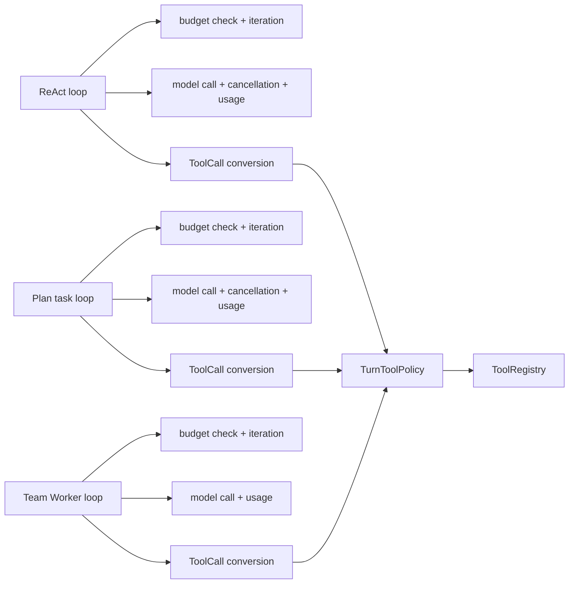
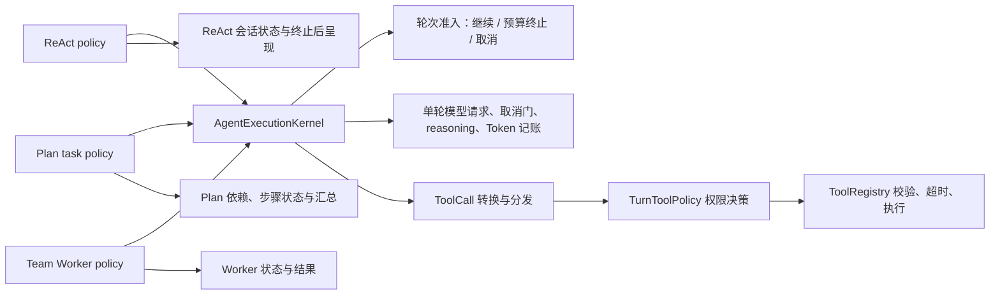

# Agent Execution Kernel 改造记录

日期：2026-10-26

## 原问题与职责边界

ReAct、Plan 单任务和 Team `SubAgent` Worker 的策略循环各自重复做了三件底层工作：判定是否准入下一轮并递增轮次、调用 `LlmClient.chat` 并记录 reasoning/Provider Token、把模型 ToolCall 转成 `ToolInvocation` 后提交给工具策略。复制这些步骤会使取消、预算记账和模型响应处理逐步分叉。

工具权限、参数校验、超时和实际执行已经由三种模式共同使用 `TurnToolPolicy` / `ToolRegistry`；本轮没有再造工具框架。ReAct 对话账本、Plan 依赖/步骤状态、Team 调度和 Reviewer 决策各有不同语义，也继续由上层策略维护。

## 改造前后

### 改造前

### 改造后

## 实际迁移

`AgentExecutionKernel` 已被 ReAct、Plan task 和 Team Worker 的真实执行路径调用，统一承接预算准入/轮次递增、模型请求/Usage 记账/取消响应、ToolCall 转换与既有策略分发。模式仍决定何时更新上下文、如何更新各自状态，以及预算耗尽后如何收尾。

取消如果发生在模型请求期间，内核记下已产生的 Provider Token，不再把响应中的工具决策交给执行层。Provider IO 异常仍由调用策略按原有用户体验处理。

## 验证与运行数据

- 定向回归：85 tests，0 failures / errors，覆盖 ReAct、Plan、Team Worker、预算、取消、账本和执行观察。
- 离线 Harness：35/35 通过。
- 同一 DeepSeek 模型、同一 Harness 数据集 SHA-256 `f58399cd59efadca5fbafeb6715f78b09dbc87e9dc47817185a23f3272cb5a28`：改造前 12/12，改造后 12/12。最终 L08 也通过，Trace ID `330d00ef2cda4801c2038f8c15bafc81`。
- 单次真实批次对比：模型调用 29→30；工具调用 12→13；输入 Token 104,428→108,110；输出 Token 3,375→3,807；总耗时 41,547→57,129 ms。当前批次比基线多一次模型和工具调用，来自 L05 模型额外产生的空路径 `read_file` 调用（该调用失败，原题仍按标准答案及预期失败/成功路径判通过）。这是真实观察到的波动；因为只有单次对照且 DeepSeek 请求使用 temperature=1.0/top_p=0.95、没有固定 seed，不能归因于内核，也不能宣称性能改善。该用例判定器目前允许最低工具调用数，未限制额外调用，这是待进一步评测的问题。
- 本轮成本为 unavailable：运行时间不在已核实的定价快照计价窗口；不与改造前估算成本比较。
- Langfuse 云端 12/12 Trace 已读回；12/12 单根、无悬空父节点、task ID 和工具 call ID 匹配；30/30 模型 Usage 一致，无非空 Observation 正文或测试/凭据哨兵泄漏。最终 L05 Trace 显示 4 个 Generation、3 个 Tool Observation，其中 2 个 ERROR；最终 L08 有 1 根 Trace、8 个 Generation、无工具调用。

## 代码与结果文件

- 共享内核：`src/main/java/com/paicli/agent/AgentExecutionKernel.java`
- 迁移执行路径：`src/main/java/com/paicli/agent/Agent.java`、`PlanExecuteAgent.java`、`SubAgent.java`
- 定向测试：`src/test/java/com/paicli/agent/AgentExecutionKernelTest.java`
- 本轮真实模型结果：`benchmarks/harness-live/results/agent-execution-kernel-2026-10-26.json`
- 本轮云端 Trace 核验：`benchmarks/harness-live/results/agent-execution-kernel-cloud-2026-10-26.json`
- 本轮离线结果：`benchmarks/harness-offline/results/agent-execution-kernel-final-2026-10-26.json`

## 尚未迁移与下一步

> 下段是阶段三结束时的历史状态。阶段四的无工具收尾已迁到 `requestFinalizationTurn()`；阶段五的新结果见后文，不重复实施阶段三、四。

Plan/Team 的 Planner、并行调度、Reviewer 验收循环没有合并；预算最终化调用仍由各模式分别处理。下一阶段建议按本轮目标验证 Team/Plan Worker 并行时的 Trace 父子关系和取消隔离，并检查 L05 对额外工具调用是否应有明确上限。完整 `mvn test -Pquick` 本轮未重跑；已知的 143 failures 和 600 errors 已在未改动 HEAD 基线上复现。

## 阶段五：明确执行结果与终止原因

### 源码确认的问题

- Plan 的 `finalizePartialTask` 原来返回普通 `TaskRunResult`，上层只区分是否抛异常，因此无异常的预算收尾会进入 `task.markCompleted`，依赖步骤可能继续执行，整份计划也可能显示成功。
- Worker 的预算收尾返回普通 RESULT，Orchestrator 只检查 ERROR、空文本和 Reviewer 结果，可能让部分结果被标成 COMPLETED。已有观察测试甚至明确断言预算收尾后的 COMPLETED，此次针对该行为修正了断言，而不是放宽验证。
- ReAct 没有同样的调度状态误判，其预算出口本来就返回部分完成提示；不为追求统一而改变其字符串 API。

### 实际生产改造

新增小型 `ExecutionOutcome(reason, content)`，共享正常完成、三类预算停止、取消和模型/执行异常的原因表达。Plan 的任务返回和批次返回都携带它；Team 的 AgentMessage 增加 outcome，保留原有四参数构造和消息类型。

Plan 在消费任务返回时先判断 outcome，预算停止保存部分内容、阻止依赖任务，不走异常重规划；Task 仍使用原有 FAILED 状态承载未完成任务，具体原因单独保留。未流式展示的部分内容进入最终汇总。Team 在首次 Worker 和审查重试 Worker 的返回处统一判断终止原因，预算停止时保留内容、停止审查/重试，不再放行依赖；观察事件补充 WORKER_INCOMPLETE，并记录部分内容来自哪个 Worker activation。

修改生产文件：`ExecutionOutcome.java`、`AgentMessage.java`、`PlanExecuteAgent.java`、`SubAgent.java`、`AgentOrchestrator.java`、`TeamExecutionObserver.java`、`plan/Task.java`。没有重复执行阶段四的 Kernel 请求迁移，没有新增真实模型调用。

### 验证

第一批针对性测试：AgentExecutionKernelTest 7、AgentBudgetFinalizationTest 2、PlanExecuteAgentTest 13、SubAgentTest 5、AgentOrchestratorTest 15、AgentMessageTest 9、TeamExecutionObservationTest 17、PlanExecutionObservationTest 8，共 76 项，0 failures / errors / skipped。

之后只针对新增的 `AgentOrchestratorTest#budgetStopDuringReviewRetryDoesNotStartAnotherReview` 再运行 1 项，通过。因此本阶段共验证 77 个不同测试；没有把多次重复运行的同一用例累加成测试数量。命令均显式使用 `-DskipTests=false`。新增回归覆盖 Plan 不放行依赖且不重规划、Team 首次/重试预算停止不再审查、终止原因不依赖正文措辞，已有预算单测和观察单测也保留了无工具、Token、部分内容等断言。

### 保留的边界与未解决项

各模式的提示词、对话记录、Memory 汇总、UI 收尾继续原地处理；工具错误仍可由模型下一轮纠正，不直接转换成任务失败。取消仍按各调度器原有方式收尾，没有实现跨线程 Checkpoint 或取消后的完整进度恢复。Reviewer 失败时保留执行结果、审查重试耗尽后保留结果的既有策略没有改动。ReAct 仍为字符串返回，本阶段没有把全部 Runtime API 改成新类型。

本次只验证模拟客户端单元测试；未运行真实模型评测、Docker、大型 Benchmark 或云端 Trace 核验，不宣称成功率、性能或成本改善。

## 阶段六：有限且安全的 Plan 恢复准入

### 审计依据

模型请求由 `AbstractOpenAiCompatibleClient` 配合 `LlmRetryPolicy` 管理：默认最多 3 次尝试，分类处理临时 HTTP/网络错误，带指数退避、抖动和 Retry-After；收到可消费的流式输出后不重试，OkHttp 隐式连接重试已禁用。这条路径已有实现，不重写。

原 Plan 在任务异常且进度低于 50% 时，只看重规划次数就重新规划，既不知道客户端已经重试，也不知道这份计划是否已执行工具。模型最终失败可能引起额外请求；已写文件、执行命令或调用 MCP 工具的计划也可能被从头重做。工具本身没有通用幂等声明，无法证明重做安全。MCP 断线重启用于恢复连接，没有在本阶段加入工具请求重放。

### 实际改造与生产路径

新增 `FailureRecoveryPolicy`，让 Plan 原有异常出口先做恢复准入。不是在 Kernel 再加一层重试循环，也没有合并三种执行模式。

- `LlmClient` 新增 `managesRequestRetries()`；OpenAI 兼容传输声明 true，Profiled 包装器透传。所有当前内置聊天供应商沿此路径使用现有 HTTP 恢复策略。
- `PlanExecuteAgent` 在原来调用 planner.replan 前消费决策。客户端拥有内部重试时，最终 IOException 不再重做任务。
- `Task` 记录是否尝试过工具；标记在真实工具调用前设置，覆盖返回不确定的副作用。检查范围是当前整份计划，包括已完成或同批其他任务。
- 保存剩余硬轮数，结合已用重规划次数判断，不因新建计划就重置原有轮数限制。Token/停滞退出与阶段五结果仍禁止自动恢复。
- 已取得的工具输出写入 Task；后续模型异常时仍在失败汇总中保留，明确标为部分输出，依赖任务继续跳过。

本轮修改 6 个生产文件：`agent/FailureRecoveryPolicy.java`（新增）、`agent/PlanExecuteAgent.java`、`plan/Task.java`、`llm/LlmClient.java`、`llm/AbstractOpenAiCompatibleClient.java`、`llm/ProfiledLlmClient.java`。

### 恢复条件与上限

| 情况 | 本轮决策 |
| --- | --- |
| 内置客户端最终 IOException | 停止外层重规划；HTTP 层仍按原配置至多 3 次默认尝试 |
| 不自行重试的客户端，明确临时错误，未尝试工具、预算可用 | 允许原有重规划；默认最多额外 2 次，并受剩余硬轮数限制 |
| 鉴权/权限、无效输入、未知错误 | 不进入通用自动重规划 |
| 已尝试任意工具，包括只读或结果不确定的 MCP/写文件/命令 | 保守停止整份计划重做，不自动重放工具 |
| 用户取消、预算退出、当前任务硬轮数已用完 | 停止恢复，不用新计划绕过限制 |
| 重规划达到配置上限 | 延续原有行为：停止启动剩余任务并跳过 pending 任务 |

本策略不另外 sleep；内置客户端的 HTTP 退避沿用原实现。自定义不管理 HTTP 重试的客户端使用现有有限重规划，不另外增加网络重试。没有新增统一的任务时间截止机制：当前仍使用客户端请求超时及既有 Token/轮数预算，不宣称已统一全任务剩余秒数。

### 针对性验证

最终运行 7 个直接相关测试类，共 **47 项通过，0 failures / errors / skipped**：

- PlanFailureRecoveryPolicyTest：5。
- PlanExecuteAgentTest：16。
- PlanExecutionObservationTest：8。
- PlanExecutionControlTest：3。
- AbstractOpenAiCompatibleClientRetryTest：9。
- LlmRetryPolicyTest：4。
- LlmFailureClassifierTest：2。

关键回归：本机 MockWebServer 实际收到 4 次请求（1 次规划 + 3 次 HTTP 503 尝试），没有额外重规划；写文件后连接失败不重做计划，文件内容与工具输出保留；硬轮数为 1 或 2 时不因重规划重置预算；明确临时错误仍能恢复成功，达到次数上限会停止。

旧重规划测试的故障由不明 IOException 改成明确 ConnectException；队列客户端显式声明自己没有内部 HTTP 重试。保留原有次数上限和执行 ID 隔离断言，并新增未知错误不恢复断言，没有放宽验证。过程中修正了测试构造器可见性、Planner 将任务 ID 规范化为 task_2，以及异常类型断言与新 fixture 不匹配的问题，最终上述测试全部通过。

最终将失败工具输出的追加放在异常出口，避免与预算收尾已有的部分结果重复；补强去重断言后单独复跑 PlanExecuteAgentTest，16/16 通过。这 16 项属于上述 47 项，不重复累加。

### 本阶段未扩展的范围

Team 的 Reviewer 重试、模型主动再次调用工具、MCP 连接自动重启、工具级幂等与 Checkpoint 未改造。ReAct/Worker 的底层模型 HTTP 恢复继续使用原客户端；本次统一的是 Plan 是否允许扩大为整份任务恢复。自定义客户端必须如实声明内部重试能力。没有调用真实模型、Docker、大型 Benchmark 或核验云端 Trace，不宣称生产可靠性、耗时或成本提升。

## 阶段七：模型请求取消传播

### 审计与范围

现有 `AgentBudget` 约束 Token、轮数和停滞，但没有贯穿重试与重规划的任务总 Deadline。CLI/TUI 已会取消 `CancellationToken`，而内置模型 HTTP 请求此前只检查客户端自身的取消标志；单独取消任务 Token 时，正在阻塞的 HTTP `Call` 仍可能继续。工具子进程和 Team Worker 的所有取消路径也尚未统一。本阶段选择一条可验证的纵向链路：Token → 当前模型 HTTP Call → Kernel 取消结果 → Plan 停止并保留部分输出。

### 生产代码改动

- `runtime/CancellationToken.java`：添加一次性取消回调注册与注销；已取消 Token 的新回调立即执行，一个回调异常不会阻断其他回调。
- `llm/AbstractOpenAiCompatibleClient.java`：每次请求只把当前 Token 绑定到当前 OkHttp `Call`，从发起请求到读取响应结束都保持注册；取消时撤销该 Call，跳过重试与退避。共享客户端的其他请求不受影响。
- `agent/AgentExecutionKernel.java`：请求因当前 Token 取消而抛出 `IOException` 时返回已有的取消结果；普通模型异常仍照常传播。未得到完整模型响应时不补记 Token Usage，已有正常响应仍只记一次。
- `agent/PlanExecuteAgent.java`：在任务循环、模型请求与重规划出口识别取消，停止依赖任务，保留已收到的工具输出，并明确标记 Plan 为 `CANCELLED`。原有 Task 状态继续用未完成状态，具体原因为 `CANCELLED`。

无工具收尾请求、各模式特有的最终格式和正常工具循环未改；没有引入另一套 Token、预算或 Outcome。

### 针对性验证

运行 `CancellationContextTest,AgentExecutionKernelTest,PlanExecutionControlTest,PlanExecuteAgentTest,PlanExecutionObservationTest,SubAgentTest,TeamExecutionObservationTest,AbstractOpenAiCompatibleClientRetryTest,LlmRetryPolicyTest,PlanFailureRecoveryPolicyTest`，共 **82 项通过，0 failures / errors / skipped**，命令显式设置 `-DskipTests=false`。

新增回归覆盖：回调至多执行一次、注销后不再执行、已取消后注册立即执行；取消中的模型异常返回取消结果且不重复记账；Plan 在第二轮模型调用被取消后停止依赖任务并保留首轮工具结果；本机 MockWebServer 上两个并发请求共享同一客户端，仅取消其中一个 Token，另一个请求仍成功，取消的请求没有重试。

本轮未运行真实模型评测、Docker 或大型 Benchmark。测试证明客户端发起了当前 HTTP Call 的取消，并不证明远端模型立即停止计算或计费。任务总 Deadline、工具子进程及所有 Team Worker 等待点的取消传播仍待后续评估；不能据此宣称全链路限时或取消已完成。

## 阶段八：命令进程取消传播（2026-10-27）

原路径在工具调用前检查取消，但命令启动后仅 `waitFor(commandTimeoutSeconds)`；线程中断只强制终止 shell，Token 取消没有绑定命令进程。超时出口已经尝试清理后代，但没有同等的取消路径，且取消前输出可能丢失。因此本轮选择命令子进程，不同时改 Team 调度或任务级 Deadline。

生产改动限于 `tool/ToolRegistry.java` 和 `tool/CommandExecutionObserver.java`：真实 `execute_command` 启动后立即注册当前 Token 回调，取消时保存可识别后代句柄，请求终止后代与 shell；调用线程负责有限等待退出和输出、注销回调与关闭输出执行器。启动前二次检查和已取消 Token 的立即回调覆盖启动竞争。Token 取消、线程中断和超时事件分别记录，不报告正常成功。已读取完整行和原有输出限制保留，Plan 沿用既有 CANCELLED 出口、部分结果与依赖跳过逻辑。

调用链：CLI/TUI 的取消入口 → 当前 CancellationToken.cancel() → 命令注册回调 → 本次命令的进程树终止 → 失败工具结果携带真实部分输出 → Plan 取消出口。不停止共享线程池，不取消其他任务 Token。

针对性验证使用真实 Windows PowerShell → Java → Java 进程树，模型和 Planner 为受控返回，不访问真实模型：

- `CommandCancellationTest`：2 项，验证实际 shell 与后代退出、部分输出保留、后续写文件不执行、另一独立任务不受影响、启动竞争与输出线程清理。
- `PlanExecutionControlTest`：6 项，新增真实命令取消后只发出首个模型请求、没有重规划、保留输出、计划 CANCELLED、依赖任务 SKIPPED 的检查。
- `CommandExecutionObservationTest`：10 项，保留普通退出、非零退出、超时和线程中断等检查。
- `AgentExecutionKernelTest`：8 项；`PlanExecuteAgentTest`：16 项。以上五类合计 42 项通过，0 失败、0 错误、0 跳过。
- 同次包含 `ToolRegistryTest` 的 85 项运行结果：78 通过、1 断言失败、1 错误、5 项原有平台跳过。失败分别为 `commandExitCodeControlsTypedToolSuccess` 假设 PowerShell 存在 `printf`（本机不存在），以及 `commandSandboxBuildsEscapedSeatbeltProfileAndDirectArgv` 在进入工具执行前就用带双引号目录名触发 Windows InvalidPathException。本轮未修改这些测试或生产代码绕过它们，也未对完整历史套件重新建立基线。

首次测试中，子进程写就绪文件不能保证 PowerShell 已转发其标准输出，部分输出断言曾失败一次；fixture 改为由 shell 在启动 Java 树前发出真实输出，保留原断言。生产实现仅保证保留已读取的数据，不承诺强制终止时挽救子进程内部尚未刷新的缓冲。最终代码完成后运行上述 85 项，另对输出线程清理补强断言后单独运行 2 项取消测试；重复运行不累加为更多用例。

清理依赖 ProcessHandle 可见的进程关系，没有 Windows Job Object 或 POSIX 进程组隔离。已脱离的后台进程、取消瞬间新产生的后代及其他平台没有同等保证。等待进程和输出各有 2 秒上限，输出执行器关闭再最多等 2 秒；操作系统级终止与流关闭仍依赖平台行为。没有运行真实模型、Docker、大型 Benchmark 或云端 Trace 核验。Team Worker 的提交/等待/Reviewer 取消，以及其他工具仍留待下一轮；任务级 Deadline 尚未实施。

## 阶段九：Team Worker 取消传播与隔离（2026-10-27）

### 原因与实际改动

原 Team 依赖线程创建时继承 Token，`CancellationContext.current()` 没有本地值时还会借用最后一个全局 Token；批次直接 `Future.get()`，取消后的清理没有等待上限。Worker 返回后原取消分支用“用户取消”覆盖内容，Reviewer 的 ERROR 分支可能保留为成功，重试入口也缺少取消检查。SubAgent 的取消结果只有提示语，没有已有工具输出。

修改三个生产文件：

- `runtime/CancellationContext.java`：新增只取调用线程 Token 的查询，以及 `bind()` 作用域。池线程显式使用捕获的 Token，结束后恢复原有上下文；没有创建第二套取消信号，也未删除其他模式仍在使用的全局回退。
- `agent/AgentOrchestrator.java`：Team 入口固定调用方 Token，没有时创建本次独立 Token。单步和并行 Worker 均显式绑定到本次批次私有执行器，单步仍直接流式输出。检查提交、Worker、Reviewer 和重试入口；取消后移除排队任务、中断当前批次，最多等待 6 秒收集返回结果。保留已完成和已返回的部分结果，根观察状态 CANCELLED，未完成步骤沿用 FAILED 并记录取消原因。拒绝同一实例并发执行，以及清理超时后在旧执行器退出前复用角色。
- `agent/SubAgent.java`：取消结果保留真实工具输出与当前响应已经收到的正文，使用已有 ExecutionOutcome.CANCELLED，并追加会话记录；不补造未取得的 Token Usage。

真实路径：CLI/TUI 的根 Token → Team 入口固定作用域 → Worker 显式绑定 → Kernel/HTTP 客户端或 ToolRegistry → 当前 Call.cancel() 或命令进程树终止 → Worker 的取消结果 → 调度停止与取消汇总。不同 Team 使用各自根 Token 和批次执行器，可以共享模型客户端，不会调用共享客户端的全局取消。

### 针对性验证

最终运行 10 个测试类，**85 项通过，0 失败、0 错误、0 跳过**：

| 测试类 | 数量 |
| --- | --- |
| TeamCancellationTest | 6 |
| CancellationContextTest | 4 |
| AgentOrchestratorTest | 16 |
| SubAgentTest | 5 |
| TeamExecutionObservationTest | 17 |
| AgentExecutionKernelTest | 8 |
| CommandCancellationTest | 2 |
| CommandExecutionObservationTest | 10 |
| AbstractOpenAiCompatibleClientRetryTest | 11 |
| PlanExecutionControlTest | 6 |

新回归覆盖：

- 本机 MockWebServer 接到取消 Team 的两个真实 HTTP Call 和独立 Team 的一个 Call；取消前者后两个 Call 均 `isCanceled()`，另一个未取消且最后成功。没有排队 Worker 的请求、Reviewer 或重试请求，服务端总请求数仍是 3。它是本地 HTTP 验证，不是真实模型评测。
- 取消发生于 Reviewer 和重试 Worker 时，不继续审查或重试，保留首次结果和真实流式部分内容。
- 完成一个步骤后，下一批 Worker 真正运行 Windows PowerShell → Java → Java；取消后进程退出，保留前面已完成步骤与命令已读输出，排队步骤不启动。这是实际子进程验证，模型/规划仍由受控客户端返回。
- 已预热的池线程正确绑定和恢复 Token；没有调用方 Token 的 Team 不借用另一任务的已取消全局 Token。
- 故意忽略中断的自定义客户端：根任务在清理上限后返回取消，同一实例暂时拒绝新任务；测试随后主动释放该客户端。这个用例证明有界等待，不证明强制杀死 Java 代码。

过程中保留并调查了两类验证问题。第一类是阶段八的进程夹具在临时工作目录中重新计算相对 classpath，子进程可能自行启动失败；现改为从已加载测试类的 CodeSource 取得绝对路径，没有放宽进程存活或退出断言。第二类是共享 `target` 批次曾出现 `LangfuseTelemetry$ChatCall`、`Planner$PlanningStreamRenderer` 类加载失败及连带断言失败，同时观察到本轮之外源码及构建输出更新。为排除输出目录干扰，使用当前 POM 的临时副本，仅将 build.directory 改为 `D:/pailcli/stage9-validation-build`，测试选择和断言不变；独立输出中上述 85 项全部通过。未修改原 POM，临时副本校验后移除。

测试命令的测试选择为 `-Dtest=TeamCancellationTest,CancellationContextTest,AgentOrchestratorTest,SubAgentTest,TeamExecutionObservationTest,AgentExecutionKernelTest,CommandCancellationTest,CommandExecutionObservationTest,AbstractOpenAiCompatibleClientRetryTest,PlanExecutionControlTest`，显式使用 `-DskipTests=false`。最终日志在 `target/stage9-isolated.log`，Surefire 报告在 `D:/pailcli/stage9-validation-build/surefire-reports`。阶段八 `ToolRegistryTest` 的 1 项断言失败、1 项错误和 5 项平台跳过未在本轮重跑或修复；本轮“85 通过”不包含这个测试类，也不代表完整套件通过。

### 边界

没有真实模型评测、Docker、大型 Benchmark、云端 Trace 核验或性能/成本改善数据。保留模型和命令已有取消机制及进程树平台限制；未证明任意 MCP、其他网络工具、自定义客户端都能真正停止。6 秒只约束取消后的等待，不能强制终止忽略取消的 Java 操作，也不能保证清理完成前最后一刻产生的内容都进入已返回汇总。清理未结束的实例不会立即复用，独立实例继续执行。没有引入任务级 Deadline，后续再评估统一截止时间。
