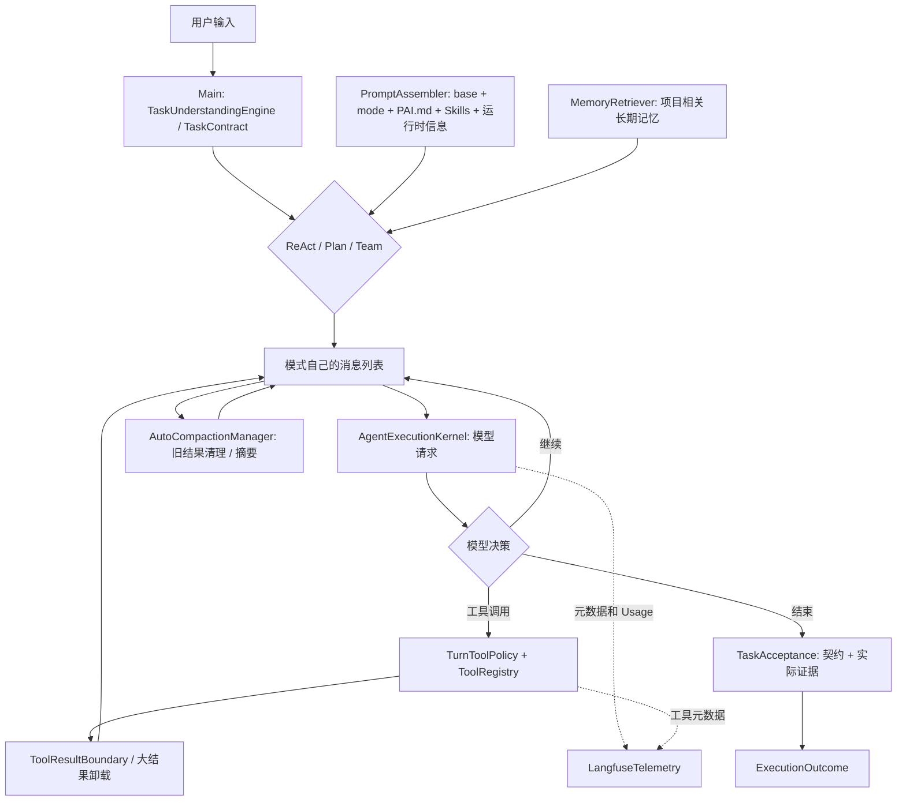
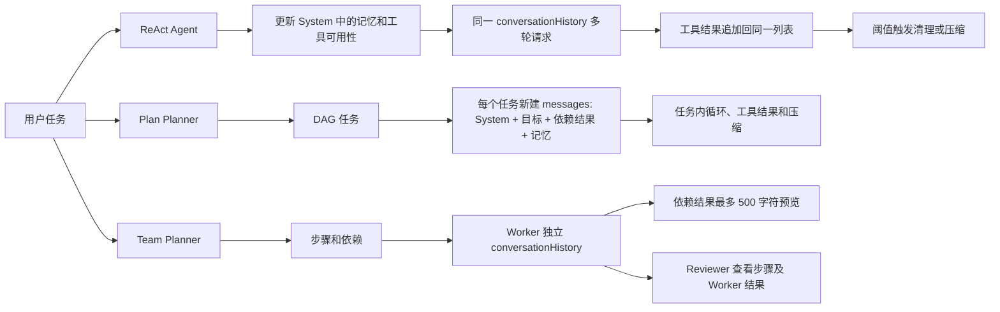
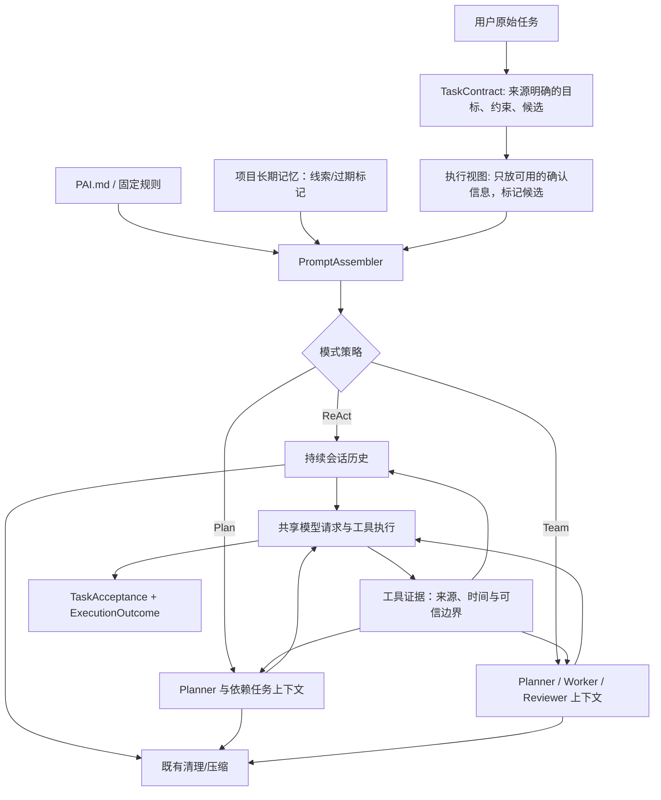
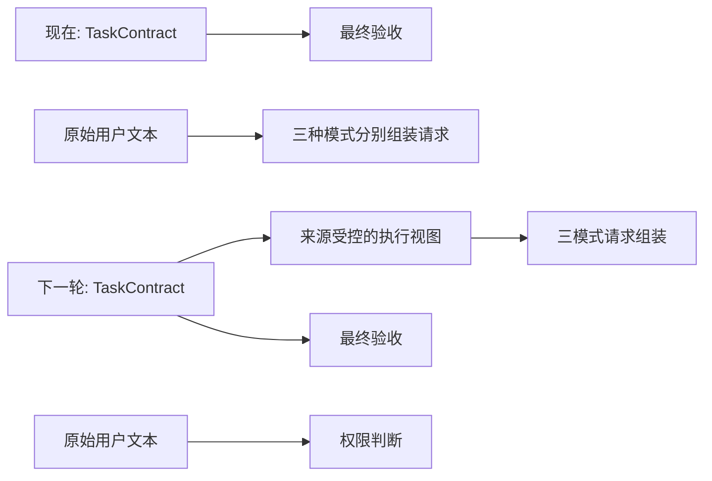

# PaiCLI Context Engineering：全局审计与升级规划

日期：2026-10-30。范围：当前工作区源码、已保存的 Langfuse 云端核验结果与真实模型评测文件。**本轮只审计和设计，没有修改生产代码，也没有发起新的真实模型请求。** 以下的“源码确认”“历史运行证据”“待验证”分别表示不同证据等级。

## 结论先看

PaiCLI 已有真实运行的上下文基础：分层 System Prompt、项目 PAI.md、按相关度检索的长期记忆、三模式的消息历史、工具结果不可信边界、超大工具输出卸载、清理旧工具结果、摘要压缩和按模型窗口计算的阈值。这不是一个缺少 Context Manager 的项目。

**最明确的跨模式断点是 TaskContract 的执行视图没有进入模型上下文。** CLI 已在模式选择前构造契约；ReAct、Plan、Team 都接收同一对象，但执行类主要取 `goal` 保留原始用户任务供策略判断，并把契约交给 `TaskAcceptance.fromContract` 做最终验收。模型运行时仍主要收到原始任务文本和模式自己的上下文。`TaskUnderstandingEngine` 花费一次可选模型请求产生的 `semantic` 候选信息，除确认提示外不稳定进入执行请求。这是源码确认的连接缺口；是否因此降低成功率、浪费多少 Token，目前没有同口径实验。

下一轮只做一项生产改造：**构造有来源标记、长度受控的 TaskContract 执行视图，并在三模式首次模型请求中接入。** 用户明确要求、用户确认后的要求与模型候选必须分开；模型候选不能扩大权限或成为验收证据。保留原始用户文本供权限判断。先迁移一条 ReAct 垂直路径，再接 Plan Planner / Team Planner 与 Worker。用同一任务集对照正确性、上下文覆盖、请求次数、输入 Token 和耗时；没有实测提升前只报告结构性修复。

## 1. 当前上下文生命周期

真实入口：`Main.java:988-1093` 在交互式 CLI 创建根作用域、理解契约、确认并选择模式；`Agent.java:177-262`、`PlanExecuteAgent.java:329-369`、`AgentOrchestrator.java:191-246` 接收契约。旧字符串入口仍可调用 `TaskContract.understand`。理解阶段是无工具请求，`TaskUnderstandingEngine.java:24-50`；它不扫描项目源码。

### 三种模式的实际消息流

ReAct 的 `Agent.java:242-359` 检索长期记忆、重建 System、追加用户输入，然后每轮在模型请求前做维护、按实际开放工具更新工具说明，工具结果经 `ToolResultBoundary` 加回历史。Plan 的 `PlanExecuteAgent.java:793-816,862-956,1354-1391` 为每个任务建立消息列表，放入完整依赖任务结果与按任务描述检索的记忆。Team 的 `AgentOrchestrator.java:860-888` 只把已完成且列为依赖的步骤结果预览传给后续 Worker，单条正文最多 500 字符；`SubAgent.java:279-359` 再使用自己的历史和工具结果。Reviewer 在 `AgentOrchestrator.java:688-727` 读取 Worker 结果并审查。

## 2. 组件与职责

| 组件 | 已有真实职责 | 边界 |
| --- | --- | --- |
| `TaskContract` / `TaskUnderstandingEngine` | 原文、规则解释、来源标记；复杂任务至多一次无工具语义理解 | 契约已传给三模式，但结构化理解主要服务确认与验收，未形成统一执行消息 |
| `PromptAssembler` / `PromptContext` | 按模式拼装模板、审批、上下文管理规则、Skill 索引、日期、项目与记忆上下文 | 模板拼装与具体执行策略分离；动态项目上下文在尾部 |
| `ProjectMemoryLoader` | 读取用户/项目 PAI.md 与导入，限制 24,000 字符、深度 3 | 这是静态项目规则，不是按任务发现相关源码 |
| `MemoryRetriever` / `MemoryManager` | 项目可见的长期事实打分排序，最多 10 条，受记忆 Token 上限约束；标记待核实/过期 | 排序只覆盖长期记忆，不能代表文件或工具证据排序 |
| `Agent` / `PlanExecuteAgent` / `SubAgent` | 各自组装实际发给模型的消息并维护短期历史 | 三种模式的策略和消息生命周期不同，不应合并成一个循环 |
| `ToolRegistry` / `ToolResultBoundary` / `ToolResultOffloader` | 实际工具调用、结果回灌、外部内容不可信标记和超大输出卸载 | 工具结果可作为证据，但正文不是授权指令 |
| `AutoCompactionManager` / `ConversationHistoryCompactor` | 先清理旧工具结果，再视阈值采用会话记忆摘要或完整四栏摘要；只在估算净减少时替换历史 | 摘要不能代替原始证据，也不能以短文本直接宣称总成本下降 |
| `ContextProfile` / `TokenBudget` / `AgentBudget` / `RootTaskScope` | 模型窗口派生阈值、消息估算、局部退出预算、根请求准入和可信 Usage 汇总 | 目前没有历史/记忆/工具/模板的统一分额；估算 Token 与供应商 Usage 不同 |
| `LangfuseTelemetry` | 根任务、模型、工具的父子关系、时间、状态、可信 Usage 与少量脱敏元数据 | 默认不上传 Prompt、工具参数或文件正文，不能直接从云端重建请求内容 |

## 3. 六个审计方向与证据

| 方向 | 源码确认 | 问题与证据等级 |
| --- | --- | --- |
| 获取 | 用户可通过工具检索/读取源码；`ProjectMemoryLoader` 注入固定 PAI.md；`MemoryRetriever.java:65-112` 从长期记忆排序。`TaskUnderstandingEngine.java:24-43` 只看任务文本。 | 没有在理解阶段按任务主动发现项目文件：源码确认。Plan/Team 是否重复读同一文件：现有 Trace 只给工具名/次数，不足以确认。 |
| 组装 | `PromptAssembler.java:23-49` 拼模板及动态部分；`Agent.java:242-314`、`PlanExecuteAgent.java:793-816`、`SubAgent.java:279-329` 各自拼实际请求。 | `TaskContract.semantic` 未传入这些执行消息：源码确认。System/工具定义每次重复携带是否为无效成本：待测，缓存可能抵消部分费用。 |
| 排序与去重 | 长期记忆有相关度排序、项目过滤与过期标记；Team 依赖 URL 用 `LinkedHashSet` 去重；Plan 依赖结果按任务依赖列出。 | 未见跨文件/工具证据统一排名、去重和版本刷新机制：就审计调用链而言源码确认；这不等于所有重复读取无价值，文件变化时必须重查。 |
| 压缩 | `AutoCompactionManager.java:64-81` 先清理旧工具结果，再尝试摘要；`ConversationHistoryCompactor.java:130-184` 按 user 边界切，保留近 3 轮、排除内部注入，净减少才提交。 | 摘要是文本，没有逐条回链到原始工具证据；多次摘要的信息损失风险待测。历史阶段十只观察到局部摘要变短，未证明总 Token 改善。 |
| 共享 | ReAct 保留同一历史；Plan 向依赖任务传完整结果；Team 只传依赖步骤最多 500 字符预览，Worker 各有自己的历史；Reviewer 读 Worker 结果。 | Plan 全文和 Team 截断的移交规则不一致：源码确认。是否造成漏证据或重复调查：缺少同口径执行样本，不能推断。 |
| 预算 | `ContextProfile.java:30-88` 用窗口减输出预留和缓冲得压缩阈值；`TokenBudget.java:98-125` 估算消息正文、工具参数和图片；根作用域在请求前准入并按可信响应累计 Usage。 | 缺按来源的输入上下文预算；Prompt、记忆、工具结果的占比未直接记录。预算协调的收益和风险待测。 |

### 来源、过期与信任边界

`ToolResultBoundary.java:31-44` 将工具结果包成 `trust="untrusted-data"`，防止结果正文冒充用户或系统指令。`MemoryRetriever.java:83-125` 对长期记忆标记“线索而不是事实”和过期/待核实。Plan/Team 依赖移交则以自然语言结果为主；Team 记录结构化的已确认 URL，普通文件证据并无同等通用的来源和版本信息。不能把模型生成的摘要或 Reviewer 批准当作实际文件仍然正确的证明。

## 4. 已保存运行数据能说明什么

| 数据 | 可支持的结论 | 不能支持的结论 |
| --- | --- | --- |
| 阶段十固定 12 例，修改前 29 次模型、104,135 输入 Token；修改后 31 次、114,323 输入 Token；原评分均 12/12，补充顺序审计后修改后 11/12 | 更短摘要没有带来可确认的整批 Token 收益；一次行为回归被原评分漏掉。见 `docs/harness-stage10-2026-10-27.md:31-44,79-80`。 | 不能把全部差异归因于压缩器；模型生成不固定，L05/L07 没进摘要分支。 |
| L08 基线摘要请求 759 输入、1,023 输出 Token，约 6.059 秒；当次估算历史只净减 134 Token | 某些压缩请求本身有明显成本；见同报告第 17 行。 | 不能推广为所有压缩不划算，后续轮数和事实完整性影响不同。 |
| 2026-10-29 跨模式只读 X01：ReAct/Plan/Team 均通过，分别 2/4/17 次模型请求；输入 9,421/19,648/100,112 Token | 三模式上下文和策略开销差异很大；见 `docs/harness-cross-mode-results-2026-10-29.md:13-17`。 | 样本只有一题；Team 的 17 次不能直接判为重复调查或浪费。 |
| X02 的 Team 未发模型请求，Plan 被批次硬上限截断 | 后续样本不足以比较三模式任务质量；见跨模式报告第 18-29 行。 | 不能计为 Team 模型失败，也不能算成功率差异。 |
| 历史云端核验：阶段十后批 12 条 Trace、123 Observation；31/31 Generation Usage 与本地相符、14/14 工具调用关系匹配 | 任务、模型、工具的结构性关联可用；见 `docs/harness-global-evidence-2026-10-29.md:7-9`。 | `LangfuseTelemetry` 默认不导出 Prompt/工具正文，无法从云端直接计算各上下文来源的 Token 占比或判定文件重复读取。 |

上述是读取已有本地报告和历史云端核验 JSON，不是今天重新调用 Langfuse 云端。历史成本价格快照已经过期，本轮不计算美元收益，也不运行新的真实任务。

## 5. 目标架构及职责边界

这是职责图，不是类清单。第一步仅增加“契约到执行消息”的小边界，不新建通用 Context Manager。后续按数据决定是否需要统一证据条目、排序/去重/刷新：获取发生在现有工具/记忆路径；组装由 PromptAssembler 与各模式完成；策略仍由 ReAct/Plan/Team 自己决定；压缩保留现有协调器；预算和取消复用现有根作用域；验收只认真实证据。

关键安全约束：原始用户文本继续用于 `TurnToolPolicy` 和权限判断；`MODEL_CANDIDATE` 只能以“待核实线索”形式出现，不能变成用户确认的限制、工具授权或确定性验收条件。工具返回正文仍用 `ToolResultBoundary` 包裹；不能把检索到的文件指令提升为系统指令。

## 6. 唯一第一优先级与迁移方案

**选项：TaskContract → 执行上下文的有来源、受控投影。**

选择理由：这是三个模式共同存在、可直接从真实调用链复核的断点；修复不需要改变策略循环或压缩器；前后可以用固定任务观察“用户约束是否进入每次必要请求、模型是否因此选择正确工具和完成验收”，并同时测请求/Token/耗时。相比跨 Worker 证据缓存，当前没有足够的重复文件读取数据支持先做缓存。相比再次压缩摘要，历史实验未证明整体收益。

分步生产迁移：

1. 在现有 `TaskContract` 上提供只读、短文本的执行视图；来源仍采用已有 `Source`，不另造任务对象。只包含用户明确/用户确认的信息、有限的规则解释；模型候选显著标注待核实，不改权限和验收。
2. ReAct 首次请求组装时使用它，并确保后续轮次及压缩后仍保留当前任务的关键约束。原始用户文本继续保留；避免把同一句原文完整复制两遍。
3. Plan 的 Planner 输入和每个任务输入引用同一根契约的必要信息；Team 的 Planner、Worker 输入采用同一边界，但各模式仍独立处理依赖和历史。
4. 以固定 Mock/真实工具用例先验证来源、禁止扩大授权、取消/预算/部分结果、压缩后约束保留。若允许真实模型评测，再在同模型、同参数、同工具权限和同题下比较；逐次保留，不挑最好结果。

预计涉及：`TaskContract.java`、`Agent.java`、`PlanExecuteAgent.java`、`AgentOrchestrator.java`、`SubAgent.java`，可能少量调整 `PromptContext.java` / `PromptAssembler.java`。不应修改 `AgentExecutionKernel`、`ConversationHistoryCompactor`、`ToolRegistry` 的核心逻辑来完成此切片。先核对各模式 Planner 的实际构造点再落代码。

预期变化：

验收指标：用户明确约束在首次及后续必要请求中出现的比例；候选被误当要求/授权的次数（必须为零）；有明确验收标准的任务正确率；实际模型请求和工具调用数；可信输入/输出 Token；端到端耗时；摘要前后关键约束保留率。模型请求的完整内容只在安全的本地受控测试中核查，云端继续只保留脱敏元数据。

## 7. 暂时不做与未知项

- 不重写压缩器；阶段十没有证明更短摘要能稳定降低总 Token。
- 不因 X01 Team 的单次 17 请求就删 Worker/Reviewer 或缓存文件；缺少重复读、文件版本及任务质量证据。
- 不先新增 Repository Profiler、向量数据库、全局 Context Manager 或跨模式统一大循环。
- 不把模型候选、长期记忆、工具正文当用户授权；不为节省 Token 删除仍需保留的失败证据。
- 仍未知：各来源实际占用多少输入 Token；Team 是否重复读同一版本文件；依赖预览 500 字符是否造成真实失败；多次摘要是否累积丢失事实；任务契约执行视图是否改善成功率或成本。现有元数据 Trace 无法单独回答这些问题。

**成熟度判断：**PaiCLI 已有较完整的上下文供给与长度防护，处在“多模式各自组装、有限来源治理”的阶段。距离成熟 Harness 的主要差距是任务目标/约束与执行消息的稳定连接、跨步骤证据的来源和新鲜度、按来源的上下文取舍，以及可用真实任务数据证明这些取舍有效。下一轮先修复已确认的 TaskContract 执行上下文断点，再用结果决定是否投入证据复用与刷新。
