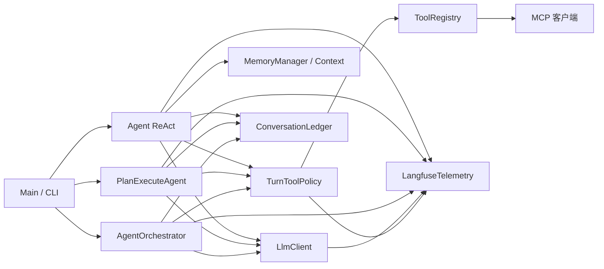

# Harness 审计与离线回归（2026-10-26）

> 后续完整回归调查见 [Harness 回归调查](harness-regression-investigation-2026-10-26.md)。下文的 `1662 tests / 134 failures / 600 errors` 是当时测试进程发生 `Java heap space` 前的中途统计；完整运行与未改动 HEAD 基线的逐方法对照、更新后的分类和修复以后续报告为准。

## 实际调用链

`Main` 创建模型客户端、工具注册表、MCP 管理器、渲染器和 `Agent`。普通输入进入 `Agent.runInternal`：创建一轮 Trace → `TurnToolPolicy` 计算工具权限 → 检索长期记忆并组装系统提示词 → 写入用户消息 → 循环执行上下文维护、预算检查、模型请求。模型返回工具调用时，先追加带调用 ID 的 assistant 消息，经策略和 `ToolRegistry.executeTools` 执行，再按原调用 ID 追加 tool 消息；没有工具调用时追加最终回答。`ConversationLedger` 记录消息和视图检查点，`/resume` 按记录恢复。`/plan` 和 `/team` 分别走 `PlanExecuteAgent` 和 `AgentOrchestrator`，共用工具注册表，但有自己的执行循环。



## 已确认的问题与处理

| 优先级 | 位置和证据 | 影响与复现 | 本轮处理 |
|---|---|---|---|
| P0 | `Agent.java` 的 `IOException` 分支把错误转成字符串；`LangfuseTelemetry.observeTurn` 只在抛异常时标记失败 | 模型请求失败后，用户看到失败，根 Trace 却可能显示成功 | 显式标记 `LLM_IO_ERROR`；取消和预算收尾也标记状态；测试验证 OTLP 请求中的错误类型 |
| P1 | `LangfuseTelemetry.usageJson` 原来无条件输出 Token；`ChatResponse.usagePresent=false` 时无法证明这些数字来自模型 | 未返回 usage 的模型在 Trace 中被记为 0 Token | 只在 `usagePresent=true` 时输出 usage；否则写 `usage_available=false` |
| P1 | `AgentBudget.recordTokens` 和 `check` 原来用 `int` 累加 | 大量 Token 累计溢出后可能绕过显式预算；可用接近 `Integer.MAX_VALUE` 的值复现 | 饱和累加并用 `long` 比较，增加边界测试 |
| P1 | `ToolRegistry.executeCommandOutput` 超时后只取消输出读取任务，未等待读取线程退出；Windows 用例首次运行在 JUnit 清理项目临时目录时被进程占用 | 超时后可能留下短暂的目录占用，影响后续操作与测试清理 | 先结束命令子进程，再关闭输出流并有界等待读取线程；超时用例单跑两次和全集复跑通过 |
| P2 | `AgentConversationLedgerTest.planModeWritesIntoTheSharedLedgerWithTaskActor` 在本轮修改前失败 | Plan 会话记录断言未满足；本轮未定位为产品缺陷 | 保留原始失败，不归因于本轮改动 |

`Agent` 同时负责上下文、流式展示、工具回灌和会话记录，职责较多；三条执行路径各有循环。这里尚无足够证据支持重写或合并。MCP、并行 Worker、Reviewer 和恢复已有测试，但本轮没有完成全路径故障注入，不能推断它们整体可靠。

## 固定离线评测

`benchmarks/harness-offline/cases.json` 固定 35 项确定性测试，覆盖预算和停滞、工具参数与超时、MCP schema 和单点故障、会话恢复、权限边界、长工具输出、长期记忆作用域、分段摘要、Plan/Team 失败隔离与重试、OTLP 脱敏。运行：

```powershell
./tools/run-harness-offline-eval.ps1 -Output target/harness-offline-result.json
./tools/run-harness-offline-eval.ps1 -Output target/harness-offline-next.json -Baseline target/harness-offline-result.json
```

脚本按方法精确运行 Maven/JUnit，读取本次生成的 Surefire XML，输出用例 ID、目标、预期、结果、失败类别、耗时、错误和版本；缺失报告判失败。`regressions` 只统计与基线共有用例中新增的失败，`newCases` 单列新增用例。它是**离线回归通过率**，不是有真实模型参与的 Task Success Rate。模型调用数、工具执行数、Token 和成本暂记 `unavailable`，不使用估算值冒充实测。尚未覆盖模型请求超时、长上下文压缩质量、真实任务回答质量，也没有 LLM-as-a-Judge 评分。

基线（20 项）20/20；修改后共有的 20 项仍为 20/20，新增失败 0；扩展 15 项后，完整集合最终为 35/35。扩展集合首次运行是 34/35：命令超时用例在 Windows 的 JUnit 临时目录清理阶段因进程占用报错，修复并单独复跑后，完整集合为 35/35。基线采集发生在遥测改动之后、Token 溢出修复之前，因此它仅能用于衡量后一项改动的固定回归，不能量化遥测改动的前后收益。首次基线命令按测试类运行，连带触发了上述 Plan 会话记录的既有失败，故 Maven 总退出码为 1；固定 20 项本身均通过。之后脚本改为按方法精确选择，修改后 Maven 退出码为 0。两次均为 Mock/离线测试，不能据此宣称真实 Agent 成功率提高。

原始 JSON 保存在 `benchmarks/harness-offline/results/baseline-2026-10-26.json` 和 `benchmarks/harness-offline/results/after-2026-10-26.json`。后者包含工作区源码指纹，便于区分同一个 Git 提交上的未提交实现版本；较早采集的基线没有该指纹。

定向 `AgentBudgetTest,AgentBudgetFinalizationTest,LangfuseTelemetryTest` 通过，`mvn package -DskipTests` 通过。`mvn test -Pquick` 没有整体通过：Surefire 汇总 1662 项、134 项断言失败、600 项错误、74 项跳过。XML 分类中，除上面提到的 Plan 会话记录测试外，失败类都位于 `eval.benchmark`；许多错误提示正式评测工件的 jar 身份或大小不满足要求。仓库规则在本轮之前已记录评测包和该 Plan 测试等既有失败，但缺少同环境完整运行的改动前 XML，不能逐项断言 733 个失败均为既有问题。

## Langfuse 使用与边界

官方支持的 Java 路径是 OpenTelemetry OTLP/HTTP：`{LANGFUSE_BASE_URL}/api/public/otel/v1/traces`，Basic Auth，`x-langfuse-ingestion-version: 4`。当前默认地址仍为 `https://cloud.langfuse.com`。设置系统环境变量 `LANGFUSE_ENABLED=true`、`LANGFUSE_PUBLIC_KEY`、`LANGFUSE_SECRET_KEY`，需要时设置 `LANGFUSE_BASE_URL`；`PAICLI_LANGFUSE_ENABLED` 作为旧别名保留。关闭可用 `LANGFUSE_ENABLED=false`。密钥缺失时仅告警并关闭追踪。

每轮输入有根 Agent Span 和独立 `task_id`，沿用会话记录的 `session_id`；模型 Generation、工具执行、ReAct 的记忆检索与上下文维护是子 Span。Plan/Team 的线程池传播父上下文。工具参数、Prompt、文件内容、工具输出和异常消息均不上传。批量异步导出，3 秒超时，退出时刷新；本地模拟 OTLP 服务已验证请求头、阶段字段、敏感正文未出现、缺少凭据时关闭追踪，以及服务返回 503 时 Agent 探针仍完成。未使用真实凭据验证云端页面或 Plan/Team 并行 Trace，也未将离线测试结果同步为 Langfuse Experiment 或 Score。本地结果没有 Trace ID，因此目前还不能从某个离线失败用例直接跳转到 Trace。

## 下一轮有证据支持的工作

1. 定位并修复 Plan 会话记录测试的既有失败，再做恢复路径的故障注入。
2. 为真实模型可选评测记录可靠的调用、工具、Token 与 Trace ID；保持离线评测默认无需密钥。
3. 补充 Plan/Team 的阶段 Span 与实际云端验收，并验证导出故障在日志中的可诊断性。

参考：[Langfuse OpenTelemetry 集成](https://langfuse.com/integrations/native/opentelemetry)、[v4 迁移说明](https://langfuse.com/integrations/native/opentelemetry/migration-to-v4)、[Java 等语言的实验接入](https://langfuse.com/docs/evaluation/experiments/experiments-via-opentelemetry)。
