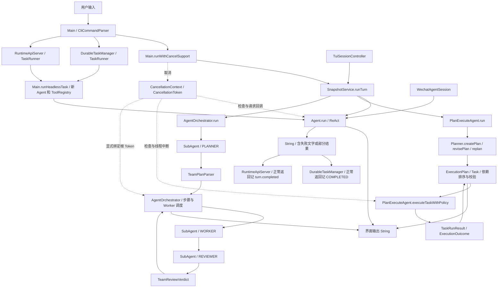
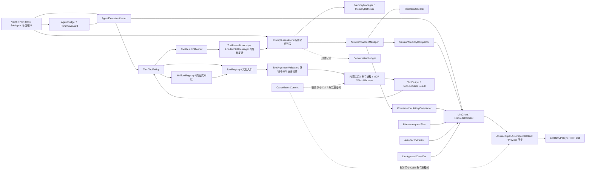
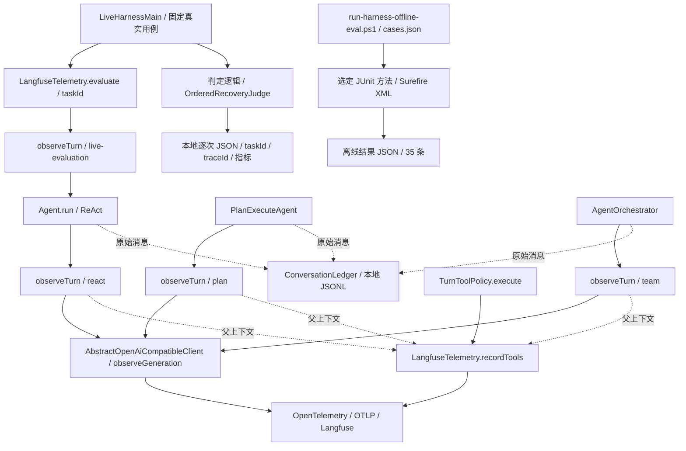
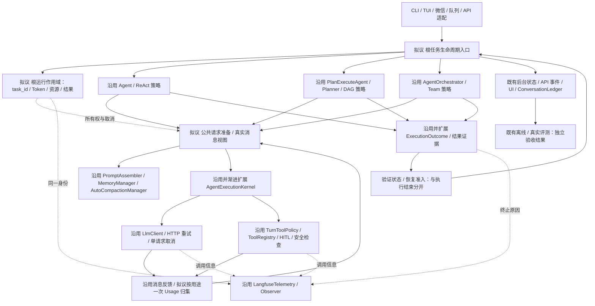

# PaiCLI Harness 总体架构审计与目标设计｜阶段十二

审计日期：2026-10-27。源码位置：`D:/pailcli/paicli-main`。HEAD：`37b09ee`，有阶段三至十一等尚未提交的工作区修改；本报告审计的是工作区源码，不是干净 HEAD。源码定位与关键文件 SHA 见 [evidence.json](harness-stage12-evidence-2026-10-27.json)。

## 先用大白话说明结论

现在 PaiCLI 的底层执行已经有不少公共代码，不能再说它没有 Runtime。真正不完整的是：**内部知道为什么停下来，走到任务入口和结果存储时，却往往只剩一段文字。** 例如 Agent 把模型异常转成“调用失败”的文字，后台任务收到文字后会记为 completed；预算停止和用户取消也没有统一的根任务结果出口。

下一阶段优先让“完成、部分完成、失败、取消”的结构化结果从 Agent 一直传到后台任务和 API。随后统一根任务取消与资源归属、模型请求准备与用量归集、Team 的审查与恢复边界。保留 ReAct、Plan、Team 各自的决策和调度方式，不把三种模式重写成一个循环。

这是一份实施蓝图，**本轮未修改生产代码、测试、用例或历史评测结果，未运行模型、Docker 或测试套件，也未重新连接云端**。源码证明的行为、可能的并发风险和历史实测分开陈述；没有新增性能或成功率结论。

## 1. 审计方法与覆盖范围

直接阅读并对照调用者，覆盖以下源码，而非根据类名推断：

| 范围 | 读取的真实组件与确认内容 |
| --- | --- |
| 输入和任务入口 | `Main` 的普通输入、/plan、/team、后台与 serve 分支，`TuiSessionController`，`WechatAgentSession`，`TaskRunner`，`DurableTaskManager`，`RuntimeApiServer` |
| 决策和执行 | `Agent`，`PlanExecuteAgent`，`Planner`，`ExecutionPlan`，`Task`，`AgentOrchestrator`，`SubAgent`，`AgentMessage`，`TeamPlanParser`，`TeamReviewVerdict` |
| 运行控制 | `AgentExecutionKernel`，`ExecutionOutcome`，`AgentBudget`，`FailureRecoveryPolicy`，`RunawayGuard`，`CancellationContext`，`CancellationToken` |
| 模型 | `LlmClient`，`AbstractOpenAiCompatibleClient`，`ProfiledLlmClient`，`DeepSeekClient`，`LlmRetryPolicy`；另检查 Planner、摘要、事实提取和审批分类器的直接 chat 调用 |
| 工具 | `TurnToolPolicy`，`ToolRegistry`，`HitlToolRegistry`，`LlmApprovalClassifier`，`ToolArgumentValidator`，`PathGuard`/`CommandGuard`，`ToolOutput`，`ToolResultBoundary`，`ToolResultOffloader`，`LoadedSkillMessages` |
| 上下文和历史 | `PromptAssembler`，`PromptContext`，`MemoryManager`，`MemoryRetriever`，`ContextProfile`，`TokenBudget`，`AutoCompactionManager`，两种 Compactor，`ToolResultClearer`，`ConversationLedger`，`SnapshotService` |
| 观测和评测 | `LangfuseTelemetry`，`PlanExecutionObserver`/`TeamExecutionObserver`，`LiveHarnessMain`，`OrderedRecoveryJudge`，离线和真实模型运行脚本、固定用例及阶段十一归档 |

证据等级：**S** 表示直接源码控制流；**H** 表示已保存的历史执行证据；**R** 表示源码暴露的风险，尚未在本轮运行复现。S 能证明某分支会做什么，不能替代“实际线上发生过”的统计。

## 2. 当前架构：输入到任务结束

下面全部为已有类或方法。实线表示主要执行路径，虚线表示信号、记录或观测关系；图中“完成”不自动代表任务质量已验收。

路径说明：

1. inline CLI 在 `Main:995` 附近选择三种模式，`:1022` 经过取消包装与快照服务。快照记录工作区变化，不是可恢复的 Agent 运行 Checkpoint。
2. Plan 先由 `Planner` 直接请求无工具规划模型，严格解析 DAG，再由 `executeTaskBatch` 串行或最多四线程执行任务。任务内部是带工具的循环，不是把每个 Task 直接交给 `Agent.run`。
3. Team 的 planner、worker、reviewer 都是 `SubAgent`，角色决定是否开放工具。planner/reviewer 无工具；Worker 执行后 Reviewer 给 JSON 结论。Team 调度负责依赖、复审、结果保留和重试。
4. TUI 同样选择三种模式，但自己建 Token 和输出捕获；微信复用单个 Agent 与单线程池，自己管理 submit/await/cancel。
5. 后台/API 通过 `Main.runHeadlessTask` 创建新的 ReAct Agent，当前 `TaskRunner` 仅接收 prompt、返回 String。API 的 thread ID 用于事件存储，**并未在该路径把之前 thread 的消息恢复给 Agent**；不能把 API thread 当成已经实现的模型连续上下文。

入口的安全配置也不相同：inline CLI 配置 HitlToolRegistry 和自动审批分类器；headless 新建的是基础 ToolRegistry；微信使用 WechatToolRegistry 的限制。这些路径仍有底层参数/路径等检查，但不能声称 headless 与交互式有同样的人工/自动审批。迁移运行入口时必须显式保留各通道策略，并确认 headless 的预期权限，不能为了“统一”扩大权限或偷偷套用会卡住后台的交互审批。

## 3. 当前架构：一轮模型与工具执行

图中的 MemoryManager 查询用于 ReAct 与 Plan task；Team Worker 主要接收角色提示、项目记忆和依赖上下文，不能由这张公共图推断它也逐次调用长期记忆检索。

已经共享的职责：

- `AgentExecutionKernel.admitIteration` 检查取消和预算，并进入下一次迭代。三个执行循环都实际调用。
- `requestModelTurn` 统一取消检查、调用、返回的 Token 记账和 reasoning 日志；三个预算收尾都已经用 `requestFinalizationTurn`，它只发一次无工具请求。
- 收尾接口故意保留已有取消竞态语义：不再做普通迭代准入检查，保留返回的部分内容；底层 HTTP 仍可取消。目标设计不能把它机械改成“取消一律丢弃响应”。
- `executeToolCalls` 把模型调用转为 Invocation，经共享的 `TurnToolPolicy.execute`、`ToolRegistry.executeTools`。没有三个独立的权限实现。
- `TurnToolPolicy` 维护本分支工具暴露与可信 URL，合并策略拒绝与实际执行结果，按原顺序记录全部调用；Plan/Team 分支复制策略，显式依赖才继承可信 URL。
- `ToolRegistry` 做参数校验、工具调度、结果分类、底层安全检查；只读白名单可并行，写入和未知 MCP 等保守串行。并行批次超时、命令超时与 HTTP 超时不是统一任务 Deadline。
- HTTP 客户端已有重试与流式输出保护，取消 Token 已能取消单个 Call；命令已有可识别进程树终止。不能把它们写成尚未实现。

仍由每种模式单独实现：提示词/消息列表组装、压缩调用时机、工具结果和 Skill/图片追加、最终结果格式与 UI、记忆使用汇总、根任务退出。模式差异有合理部分，重复的机械部分也真实存在。

## 4. 当前观测、评测与持久化

`LangfuseTelemetry` 已有任务 Trace、模型 Generation、工具 Span、可靠 Usage、Call ID 与 session ID；Plan/Team 提交线程任务时使用 OTel context wrapper。工具 Span 在批次返回后记录，通过 Call ID 关联模型决策，不应画成模型 Generation 一定是 Tool 的直接父节点。共享 Trace 也不等于 task-level 质量已通过。

普通 `observeTurn` 默认自己生成 task ID，后台数据库 task ID、API turn ID 与它没有统一入口传递。真实评测通过 `evaluate(taskId, ...)` 已能关联，不需要再造第二套 Trace 系统。源码中的 `recordFailure` 和本地 Observer 是两条现有机制；某些模式把失败转换为字符串返回时，Trace 根状态不能自动从结果知道失败。不同模式的 Observer 事件、任务状态与根返回仍未统一。

云端默认只上传元数据，不上传 Prompt、工具参数和正文。本地 ConversationLedger 是原始消息记录，可能包含正文和 reasoning；与可变上下文并存不是错误，但它不是可执行消息列表，也不是全任务调度状态。`/resume` 恢复对话不等于恢复正在运行的 Worker。

固定 live 用例由 `LiveHarnessMain.executeCase` 调用 `Agent.run`，当前 SafeRegistry 只开放 read_file；不能把这套 12 例看作 Plan/Team/危险工具权限的端到端质量覆盖。离线 35 例本质是选定 JUnit 方法，不是 35 次真实模型任务。Native AgentBench 是另一个既有评测系统，本轮只识别其存在，不恢复已暂停的大规模运行，也不将其正式评分当作有效发布结果。

历史阶段十一数据仅作 H 级证据：相关单测 33、离线 35 通过；L05 修改后 1/2，另 11 例未重跑。**本轮没有新增实测，不能沿用历史数字称本轮全部通过。**

## 5. 有证据的关键问题

### P1：根任务结果退化成文字，入口再次猜测是否完成（最高优先级）

- **S**：`ExecutionOutcome:6` 已区分正常、预算、取消、模型/执行错误；Plan 的 `TaskRunResult` 和 Team 的 `AgentMessage` 已传递该类型，内部处理预算退出并非缺失。
- **S**：`Agent.runTraced:356` 捕获 IOException 后正常返回“调用 LLM 失败”字符串；预算出口 `finalizePartialResult:370` 也返回字符串，流式输出成功还可能返回空字符串。
- **S**：`TaskRunner:5` 只有 `String run(String prompt)`；`DurableTaskManager.workerLoop` 收到任何正常返回都写 COMPLETED；`RuntimeApiServer.runTurn:102` 则写 turn.completed。外层根本拿不到内部原因，**不应解析文字/emoji 来补救**。
- **S**：Plan 根结果仍是 `PlanRunOutcome(String, booleans)`，`:57` 用 `startsWith("✅")` 决定事实提取资格；Team 根 run 同样返回 String，而详细结束原因留在其 Observer。

影响三种模式与多入口。最短真实改造是 ReAct → TaskRunner → 后台/API 的结构化终止原因，而非继续新增 Kernel 包装函数。本轮未运行故障注入，因此这里是可直接推导的控制流缺陷，不声称统计到了多少真实用户误报。

### P2：根任务取消和执行资源由多个入口分别管理

- **S**：Main 创建单次 executor/Token；TUI 自己 startRun/clear；微信在提交端 startRun，复用单线程池；后台仅存 `taskId → Thread`，cancel 只 interrupt，API runTurn 没有显式根 Token 生命周期。
- **S**：`CancellationContext.current()` 在 ThreadLocal 为空时回退全局 CURRENT；Team 已专门用 `currentThreadToken()`、`bind` 与独立根 Token 避免误借，并在 Worker 中显式传播；Plan/工具的新建线程主要依赖继承。
- **R**：持久线程池复用、未绑定的后台/API 操作与全局 fallback 的组合可能借到其他任务信号；微信复用线程也有旧继承值风险。**本轮没有并发复现，不推翻阶段九已验证的 Team 隔离，也不宣称所有取消都失效。**
- **S/R**：后台启动把 RUNNING 重新放回 ENQUEUED，表示从头重跑，不是安全续跑；工具副作用已经发生的场景存在重放风险。需要明确中断后状态和恢复准入，不能把“持久化队列”当作“任意任务可安全恢复”。

问题是根任务所有权与跨入口边界，而非缺少 CancellationToken 或“先加一个 Deadline”。

### P3：模型请求准备和用量归属仍有多条路径

- **S**：三个循环都用 Kernel，但 Plan 的 `Planner.requestPlan:108` 直接 chat；完整/会话摘要、AutoFactExtractor、审批分类器也直接 chat。直调客户端仍有 HTTP 重试、取消和 Generation，不是完全绕过安全或观测。
- **S**：这些调用没有通过 Kernel 的 AgentBudget 记账；摘要方法拿到响应后只返回 content。每个 Task/SubAgent activation 新建 AgentBudget，根任务没有所有用途的统一汇总与额度口径。
- **S**：`MemoryManager.recordTokenUsage` 把一段循环累计用量作为一次 TokenBudget.recordUsage；因此其 callCount 不能当物理 HTTP 次数。可信 usage 缺失用 `ChatResponse.usagePresent` 表示，不能把 0 或估算值伪装成计费数据。
- **S**：ReAct 先做上下文维护再预算准入，Plan/SubAgent 先准入后维护。压缩可能发模型请求，故预算已耗尽/取消在不同位置被发现，不只是函数命名重复。
- **S**：阶段十一有效工具清单更新只在 Agent，Plan task 和 Worker 没有同样的按请求清单同步；三处仍各自拼工具结果、图片、Skill 和重复提醒。

不能简单强制“所有 chat 都走正常工具迭代”：规划、摘要、审批和预算收尾用途不同，迭代计数和准入语义必须显式区分。尤其不能把 TokenBudget 的上下文容量和 AgentBudget 的累计消耗合成一个数字。

### P4：Team 把“保留可交付结果”和“审查认可”合并成完成

- **S**：`TeamReviewVerdict` 对 JSON boolean approved 严格解析，已有可靠解析，不缺 Reviewer。
- **S**：`AgentOrchestrator.runStepWithPolicy:654` Reviewer 返回 ERROR 时保留 Worker 结果并 markStepCompleted；重试 Reviewer 出错时将 approved 置 true；重试上限后即使未认可，仍 markStepCompleted。下游仅看 StepStatus.COMPLETED，根任务也按所有步骤该状态判断完成。
- **S**：Plan 的 FailureRecoveryPolicy 已因取消、预算、客户端重试、已尝试工具而保守拒绝重规划，Team 的 Reviewer 修复循环不走同一恢复准入，Worker 每次 activation 有自己的预算。

“审查失败保留结果”可以是产品策略，但不能自动等于“审查通过”。这里应拆执行终止、验证结论、是否准许下游，不必马上增加幂等平台。模型审查是概率判断，也不能直接等于客观工具验收。

## 6. 当前与目标职责映射

分类：**保留**＝已有合理实现；**整理**＝能力已有但职责分散；**补齐**＝确实缺失或只有局部实现。表中的“需修改”属于后续阶段，不是本轮已完成。

| 当前能力/分类 | 当前职责位置与代码证据 | 目标边界 | 需修改生产代码 | 风险与验证 |
| --- | --- | --- | --- | --- |
| 三种策略／保留 | Agent 自决，Plan 的 Planner+DAG，Team 的 Worker/Reviewer；真实入口见图一 | 保留三种循环及调度差异，公共机制向下复用 | 不合并循环；后续只接边界 | 保持命令、依赖与串并行行为；选定已有模式测试 |
| 根任务终止／整理 | ExecutionOutcome 已在 Task/AgentMessage；根 run String；TaskRunner 正常返回即完成（P1） | 同一结构化结束原因传到入口；展示文本独立 | **是，首选** | 空流式返回、部分内容、预算、错误、取消都逐项映射；不解析 emoji |
| 根任务所有权／补齐 | Token/ID/线程池由 Main、TUI、微信、队列各自创建（P2） | 一个根运行作用域拥有身份、Token、最终结果和资源；分支显式继承 | 是，复用现有 CancellationToken | 双任务隔离、复用线程第二次任务、清理有界；未结束操作不假报已停止 |
| 普通模型轮与收尾／保留 | Kernel 的四个真实调用入口；收尾工具为空，Usage 记一次 | 保留 Kernel；普通轮/收尾用途和竞态语义明确 | 不重建；后续接根上下文 | Kernel/预算收尾既有测试；不重新开放工具 |
| 请求重试／保留 | AbstractOpenAiCompatibleClient + LlmRetryPolicy；已输出不自动重发 | HTTP 层负责物理请求重试，策略层决定是否再规划/修复 | 不增加第二套 HTTP 重试 | 本地服务核对实际请求数、流式错误、取消 |
| 多用途模型开销／整理 | Planner/摘要/事实/审批直接 chat；局部预算未归根（P3） | 按用途共用请求生命周期与一次 Usage 归集；局部迭代与根额度分离 | 是，渐进迁移 | 不双计 Kernel+client；缺 usage 标未知，按用途核对总和 |
| 工具权限与执行／保留 | TurnToolPolicy → HitlToolRegistry/ToolRegistry → Validator/安全检查；全调用结果顺序记录 | 保留此唯一策略路径，抽取上下文不能复制授权逻辑 | 原则不改；仅传入任务作用域 | 策略拒绝、HITL 修改参数、MCP、串并行边界及取消测试 |
| 上下文维护／整理 | PromptAssembler、AutoCompactionManager 已共享；三个调用顺序与结果追加分散（P3） | 共用每次请求准备和消息追加规则，策略决定任务内容与保留范围 | 是，不改摘要算法作为前置 | 真实历史就是发送视图；Tool ID、reasoning、图片、Skill、账本一致 |
| 记忆／保留+整理 | PAI.md 项目规则、MemoryRetriever 长期查询、Ledger 原始消息均已有 | 会话/分支状态和长期记忆分开，查询与压缩分开；根状态不靠摘要推断 | 只在请求准备迁移时改接线 | 不创建影子短期记忆；分支不串用历史；检索语义可保留模式差异 |
| 验证与恢复／整理 | Plan 保守重规划；Team 严格解析但调度层仍可能接受未验证结果（P4） | 执行状态、验证状态、修复准入各自明确；保留部分结果不自动满足依赖 | 是 | 拒绝/异常/上限/预算/取消矩阵；副作用 fixture 确认不盲目重放 |
| Trace/任务关联／整理 | evaluate 已关联评测；普通 observeTurn 自建 ID，API/队列另有 ID | 根 task_id 贯穿现有 Trace、结果、记录；Observer 与展示投影同一结果 | 是，沿用现有遥测 | 本地导出器先核对 ID/终止原因，再有限真实云端验证；不上传正文 |
| 评测质量／局部已有 | 固定 live 主要 ReAct/read_file；离线是选定 JUnit；历史 L05 有评分盲点 | 每阶段迁移真实路径，分别验证结构、离线和真实质量 | 有迁移才少量补测试/入口 | 不累加重叠测试数；保存每次结果、评分版本和未知指标 |
| 暂停/恢复／局部或缺失 | 审阅/HITL 可等待，/resume 恢复对话；队列仅重放 | 当前设计先定义等待和中断，真正可恢复暂停需另立证据与实施范围 | 本路线不新增 Checkpoint | 不把等待输入或重启重排队写成持久化暂停恢复 |

## 7. 目标 Harness：边界，不是新增类清单

下图是**设计目标**，方框是职责，不要求每格创建类。标“沿用”的是真实组件；“拟议”尚未实现。

### 7.1 任务生命周期与资源

根任务是“一次用户提交”，会话可以有很多根任务。Plan Task、Team Step/activation 是子工作，不能另开不相关根身份，也不能把整个会话只有一个全局取消开关。

目标状态分两部分，避免堆一个含糊枚举：

| 阶段或结果 | 含义 | 约束 |
| --- | --- | --- |
| QUEUED / RUNNING | 等待或正在执行 | 入口接受后创建身份；取消排队任务不启动任何工作 |
| WAITING_INPUT | 在进程内等待 Plan 审阅或 HITL | 仍可取消；不是可持久恢复 PAUSED，本轮不引入暂停存储 |
| CANCEL_REQUESTED / 清理中 | 用户已请求取消，操作尚未确认结束 | 不启动后续；与“所有资源已经释放”分开，沿用 Team 有界清理思路 |
| 终态 COMPLETED | 策略正常结束且满足本任务配置的完成条件 | 必须注明是否经过验证；模型不调工具只是正常停，不保证客观目标达成 |
| 终态 PARTIAL | 已有可保留工作但未完整完成 | 原因复用 TOKEN_BUDGET_EXCEEDED、HARD_ITERATION_LIMIT、STAGNATION 等，不能满足必需依赖 |
| 终态 FAILED / CANCELLED | 执行异常或取消 | 保留已知输出/Usage；不能再被较晚的普通返回覆盖 |

优先复用 ExecutionOutcome 表达终止原因；PARTIAL 是映射/内容完整性，不要求马上再建一份平行结果类型。验证状态如 NOT_REQUESTED、PASSED、FAILED、UNAVAILABLE 独立于终止原因，不能把未验证默认为通过。

只有入口/运行作用域能提交根终态，结果最多一次。它拥有 root ID、取消 Token 和本次注册的资源；会话 Agent 历史、项目 ToolRegistry、持久化队列/共享模型客户端的寿命不同，不能在一次任务 finally 中关闭共享资源。工具自身拥有进程，模型客户端自身拥有 Call，作用域通过已有取消注册通知它们，不能 dispatcher.cancelAll 误伤其他任务。

根作用域只需一个小的数据承载与 begin/finish 边界；下一阶段不机械新增 ExecutionPolicy、StepResult、Factory 等抽象。可先用增量方法把 typed result 贯通；后续需要资源归属时再加最少字段或作用域类型。

作用域引用当前通道已经配置的工具/审批策略，不负责绕过或自动放宽授权。共享生命周期不意味着所有入口共用一个可变 ToolRegistry，项目、会话和分支之间的状态归属必须保留。

### 7.2 策略边界与结果验证

- ReAct 负责让模型决定下一步工具/回答；不把是否重规划塞到 Kernel。
- Plan 负责计划解析、用户审阅、DAG 就绪、依赖结果、跳过和是否允许重规划。TaskRunResult 的部分结果不得变成 Task.COMPLETED。
- Team 负责 Worker 分配、Reviewer、并行屏障和修复调度。Reviewer ERROR 表示验证不可用，重试耗尽表示未验证成功；仍可展示结果，但不能伪装 approved。
- Kernel 负责公共模型/工具操作边界，**不拥有所有策略循环、UI 或项目记忆决策**。规划/摘要等无工具用途也应被根任务识别，但不计为普通工具迭代。
- 验证优先采用已有计划结构校验、工具结果和任务明确要求；必要时使用模型 Reviewer 并标记其来源。不为所有用户任务创建一套通用自动判分器。
- HTTP 重试只在客户端；Plan 重规划与 Team 修复属于策略恢复，先判断取消、预算、已产生的工具尝试、验证反馈及是否安全。未知副作用先拒绝自动重放，不声称已经具备幂等性。

### 7.3 每次请求与上下文的目标顺序

目标按阶段迁移，不立即改所有循环：检查终止/取消与本阶段预算准入 → 准备该分支实际消息 → 必要的记忆/诊断/图片处理 → 现有清理或摘要 → 得到实际工具暴露并同步 system → 检查最终消息+工具 schema+回复预留 → Kernel 请求 → 一次 Usage 归集 → 追加 assistant/tool/Skill/图片并同步原始记录 → 策略决定继续还是结束。

摘要可能自己请求模型，因此需标为 COMPACTION 用途并在开始前受取消和明确额度政策约束，不能“检查预算之前先花一轮摘要”。正常轮、规划、摘要、审批、事实提取与最佳努力收尾各自有准入语义，不通过普通迭代数一刀切；迁移前先冻结现有行为，尤其收尾保留语义。

发给模型的真实消息列表保持唯一；原始记录追加保留证据，不能拿记录日志代替发送视图。system 工具说明源自同一 ToolExposure，不维护另一份可用工具状态。记忆检索带入长期事实，压缩减小现有消息，两者职责不相同；顺序、未完成事项等重要状态由明确上下文约束和验证保障，不能只依赖摘要模型“应该记住”。

根任务 Usage 是所有用途调用的可信响应之和，HTTP 重试中没有响应 Usage 的花费标未知。每次响应只记一次，不能 Kernel 记一次、包装 client 再记一次。上下文 Token 为估算容量，provider usage 为实际返回计数，成本需带有效价格来源，三者不混用。局部循环额度和根任务额度可并存；不默认把现有每 Worker 限额改成一个同数值的全 Team 限额。

### 7.4 Trace 与评测的目标

复用已有 task_id/session_id/trace_id/call_id。后台已有 task_id、API turn_id 时由根入口接入，不在 observeTurn 再生成不相关 ID；普通交互新建一次 root ID。root → plan/step/activation → generation/tool 的父关系随着作用域传播，工具与决策仍通过 call_id 核对，不为好看的树而改变并行行为。

终止事件由 typed result 产生；任务验收在本地另外记录，与 Trace 结构正确、HTTP 200、工具 success 分开。先用本地 HTTP/导出器验证结构，再在后续明确授权下有限真实调用核验云端，保留所有失败记录。现有元数据脱敏边界不放宽。

## 8. 四阶段实施路线图

依赖：**十三 → 十四 → 十五 → 十六**。每阶段都必须迁移真实路径，不允许只新增未调用组件；每阶段先冻结局部行为，再运行相关回归。数字是后续实施建议，非已完成记录。

| 阶段 | 系统问题、涉及生产模块与优先理由 | 对三种模式的影响与分段迁移 | 完成后的可验证能力 |
| --- | --- | --- | --- |
| **十三：结构化根任务结果贯通** | P1，复用 ExecutionOutcome；Agent、TaskRunner、Main.runHeadlessTask、DurableTaskManager、RuntimeApiServer；再迁移 PlanExecuteAgent/AgentOrchestrator 根汇总。优先因错误可确定地被外层重判完成，影响全部入口，改造不需要模型性能假设 | 第一段 ReAct→后台/API；保留 String run 兼容展示。第二段将 Plan 的任务结果和 Team 的结束原因汇总成 typed result，原格式/UI留在适配层。先不动循环、摘要或重试 | 预算/错误/取消/部分结果穿过入口后不丢失；后台/API不再将它们记为成功，空流式返回也不误报失败 |
| **十四：根任务作用域与取消资源归属** | P2，CancellationContext/Token、Main、TUI、微信、后台/API、Plan批次、ToolRegistry并行任务、现有Team绑定。基于十三稳定终态再管理取消，防止清理竞态覆盖结果 | 先后台/API显式 Token 绑定，再复用线程入口，最后把 Plan/工具池的继承改成显式传播；Team已可靠路径接同一作用域但不重写调度。移除全局fallback前先迁完调用者 | 一个任务只取消自己的 Call/命令/分支；第二次复用线程不继承旧Token；已请求取消与已清理能分辨；根ID与Trace贯通 |
| **十五：公共请求准备与按用途模型用量** | P3，Kernel、三个循环、PromptAssembler、AutoCompactionManager、Planner、MemoryManager及调用模型的辅助组件。根身份和结果稳定后，才有可靠用量归属 | 先 ReAct/Plan task 共用工具说明与消息追加不变量，再迁 Worker；之后迁 Planner/摘要/审批等用途。各策略仍控制循环，普通轮和收尾准入分开，保留记忆差异 | 实际工具说明一致、消息反馈规则一致；根用量覆盖多用途且不双计；上下文容量估算与真实消耗可分别审计 |
| **十六：验证状态与恢复准入分离** | P4，AgentOrchestrator.runStepWithPolicy、TeamReviewVerdict、ExecutionOutcome、FailureRecoveryPolicy、Task/ExecutionPlan。依赖前三阶段的真实状态、累计开销和副作用证据 | 先把Team执行结束、Reviewer结论、下游准入分开；Reviewer异常/耗尽保留输出但不默认为认可；再协调Plan重规划与Team修复的共同准入条件，保留模式特有恢复策略 | 未验证结果不会自动满足必需依赖；取消/预算后不再启动审查或修复；未知副作用不盲目重放。独立回归比较调用数，不以额外Reviewer次数当可靠性证明 |

验证与风险按阶段：

1. **十三**：用本地可控 client 复现正常/空流式/IOException/预算/取消/部分输出，沿真实 TaskRunner 路径检查 SQLite 状态和 API事件，之后检验 Plan/Team aggregate。复用 AgentBudgetFinalizationTest、AgentExecutionKernelTest、PlanExecuteAgentTest、AgentOrchestratorTest 和 runtime 现有测试；少量补跨边界断言。不要把普通字符串 TaskRunner 兼容适配默认当成已验收成功。
2. **十四**：复用 TeamCancellationTest、CancellationContextTest、客户端重试/取消、CommandCancellationTest；两个并发独立任务、持久池连续两次运行、启动与取消竞态及清理超时。有限真实本地进程而非危险命令；不能强停的工具要报告限制。数据库已取消但后台尚在运行时，不得宣称资源已经停止。
3. **十五**：复用 PromptAssemblerTest、AgentToolExposureTest、各消息/压缩/Skill/图片测试；对比迁移前后实际请求 messages/tools、调用用途和 Usage，要求语义一致，非同实现复刻断言。辅助调用已消费但未拿到 usage 的场景要标未知。原35离线保持；真实12例在得到执行授权且配置可用时同口径对照，不把ReAct成功当Plan/Team通过。
4. **十六**：已有严格 Reviewer JSON 与依赖测试保留；补验证拒绝/异常/耗尽、已工具副作用、预算/取消的局部矩阵。要求拒绝后依赖不启动、部分结果保留；若改变了现有“尽力接受”产品语义，应明确可交付与可依赖的区别。真实模型复核只针对迁移路径，不无限重试挑最好。

所有阶段都先在本地验证根 ID、OTel 父关系、事件终止原因和无敏感外发；只有获准真实运行才报告云端验证。相同任务/模型/配置下，分别记录正确性、模型逻辑调用与物理重试、工具尝试含拒绝、Usage缺失、耗时、成本可信性。结构性收益与运行时收益分开；原完整 quick 基线失败不在此路线里顺便修。

## 9. 下一阶段具体实施单：阶段十三

**唯一主问题：结束原因必须从真实执行路径传到外层，不能在 String 边界丢失。** 首先做 ReAct→后台/API 的垂直迁移，有余量再迁移 Plan/Team 根汇总；不把全部取消改造塞到同一轮。

预计生产文件与步骤：

1. `agent/ExecutionOutcome.java`：优先沿用现有 reason/content。若 UI 需要 streamed 状态，放在展示适配或小型返回包装，不把“显示过”当“已成功”。明确预算停止/错误/取消仍可携带输出。
2. `agent/Agent.java`：新增/迁移结构化执行入口，所有实际正常、预算、取消、IOException 出口都返回明确原因；String run 保留兼容委托。核心循环仍走 Kernel，不能再通过解析返回文本分类。
3. `runtime/task/TaskRunner.java` 与 `cli/Main.java` 的 headless 接线：让真实 headless runner 保留结构化结果；必要时保留旧接口适配供已有调用者渐进迁移，禁止新增旁路后生产仍用旧 String 路径。
4. `runtime/task/DurableTaskManager.java`、`DurableTask.java`、`TaskStatus.java`：SQLite 写入真实终止原因和部分结果。优先兼容既有五种状态，以附加原因/完整性字段表达 PARTIAL；如选择新状态需同时兼容旧DB、格式化和读取，不能悄悄改未知状态为queued。取消与迟到结果终态只能决胜一次，不能覆盖。
5. `runtime/api/RuntimeApiServer.java` 与必要的事件序列化：API输出/事件从typed结果映射，不把预算收尾叫turn.completed；兼容原客户端时使用明确 reason/完整性，不靠改 message 文本。API暂不因此新增 cancel endpoint或多轮上下文功能。
6. 第二个小步再迁移 `PlanExecuteAgent.java` 根汇总和 `AgentOrchestrator.java` 根结束原因，保留局部Task/Step状态及已有部分结果。不要直接把所有子节点COMPLETED就等同客观质量通过，验证来源单列。

首个验收链：`Main.runHeadlessTask → Agent结构化入口 → Kernel模型异常/预算停止 → ExecutionOutcome → TaskRunner → SQLite/API事件`。必须观察到旧路径会误报的案例在新路径不再报告完整完成，同时正常任务的输出、空流式行为和调用次数不变。

首轮不动 Compactor、工具执行器、Deadline、HTTP重试或Team修复策略；如为了适配类型修改这些模块，只能是结果接线且说明必要性。不要一开始把四阶段一起实现。没有真实模型新数据时，只能报告状态分类改正，不能宣称成功率、速度或成本提高。

## 10. 本轮交付、限制与决策

- 当前三张架构图、目标图、映射表和四阶段路线已给出；evidence.json 保存可定位源码依据及 SHA，便于下一阶段确认代码是否变化。
- L05 仅作历史评测盲点案例，不是本轮架构中心；无新增模型请求，无算法修改、Deadline或全局重写。
- 后台/API误判终态、Team验证状态合并、多用途用量不归根是源码事实；全局取消fallback的跨入口影响和持久任务副作用重放是需要下一阶段受控验证的风险，不是本轮已复现的事故。
- 本轮只交付设计文档与源码证据，生产/测试/用例/运行脚本内容保持不变；检查 git diff --check。未跑测试，历史通过数不冒充本轮测试结果。
- 下一阶段以第9节为实施范围：**先把现有 ExecutionOutcome 接到真实任务入口与结果存储，再考虑更广的运行作用域。** 这样后续优化才能知道任务是完成、部分完成还是失败，而不是再次依赖文字或单个用例推断。
