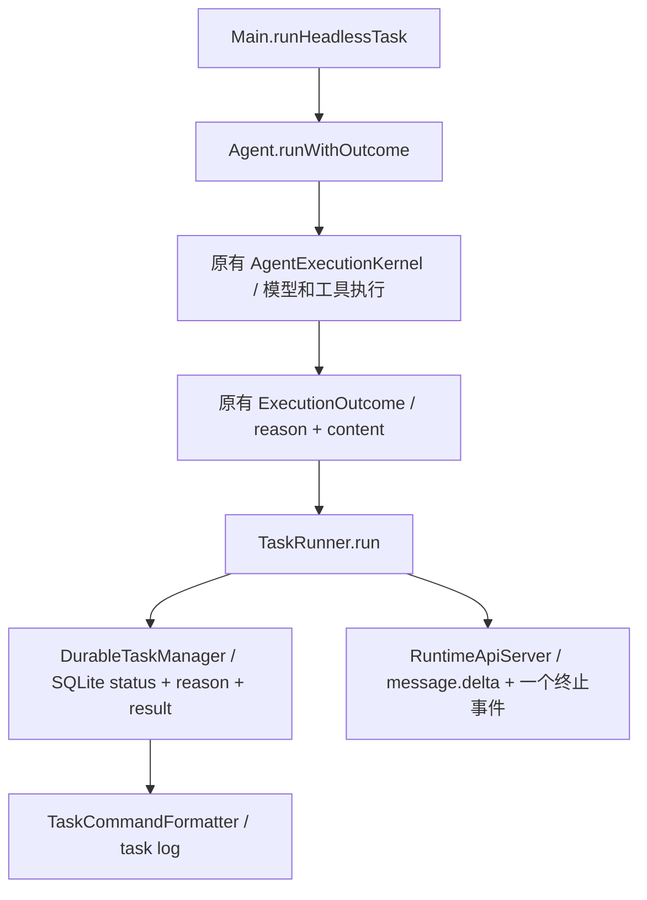

# 阶段十三：贯通 ReAct 根任务的结构化执行结果

本轮按 Notion 阶段十三要求及阶段十二蓝图，实际迁移 **Agent → Headless → TaskRunner → SQLite 后台任务 / HTTP API**。复用原有 `ExecutionOutcome`，没有新增第二套 Result/Status，也没有修改其已有原因枚举。

## 修改前的问题与实际迁移

修改前 Agent 捕获 IOException 后返回“调用 LLM 失败”的普通字符串，预算收尾也返回字符串；TaskRunner 返回 String。DurableTaskManager 对任何正常返回记 COMPLETED，RuntimeApiServer 对任何正常返回发 turn.completed，因此内部失败或预算停止会丢失原因。流式展示后 String 返回空值也不能作为机器结果。

现在实际生产链如下；两个 Main 接线（serve 和后台任务）都使用同一 typed headless 入口，没有保留生产 String 旁路：

## 实际生产文件

| 文件 | 改变的职责 |
| --- | --- |
| `agent/Agent.java` | 新增 runWithOutcome，实际普通/预算/取消/模型和运行错误出口保留原因；机器入口在已有流式展示后仍保留完整结果。原 run/runExplicitTask 保留 String 展示行为。保存已取得工具结果和当前输出片段，用于失败/取消和收尾失败时保留部分内容。 |
| `cli/Main.java` | runHeadlessTask 返回 ExecutionOutcome，调用真实 Agent.runWithOutcome；serve 和后台 manager 原接线都经过它。 |
| `runtime/task/TaskRunner.java` | 唯一抽象方法改为返回 ExecutionOutcome，所有现有生产调用者和测试调用者完成类型接线。 |
| `runtime/task/TaskStatus.java` | 共享结构化结果到既有数据库/API状态的映射，未增加状态枚举。 |
| `runtime/task/DurableTaskManager.java` | 按 outcome 写 status/reason/result；旧表增量添加 reason；终态条件更新防止迟到覆盖，取消结果可补存实际内容。取消后的线程中断标志在本次工作结束时清理，避免 worker 下一任务被残留中断影响。 |
| `runtime/task/DurableTask.java` | 增加 nullable reason，保留旧九参数构造；旧行原因保持未知。 |
| `runtime/task/TaskCommandFormatter.java` | task log 展示已知的结束原因，结果正文和原因分开。 |
| `runtime/api/RuntimeApiServer.java` | 按 outcome 发 completed/failed/canceled；附精确 reason，使用 JSON 序列化保留含制表符等正文；runner异常只提交一种终止事件。 |

## 结果映射与兼容

| ExecutionOutcome.reason | 后台/API status | API事件 | 内容 |
| --- | --- | --- | --- |
| COMPLETED | completed | turn.completed | 保留最终返回；正常正文含“失败/预算”字样不改变状态 |
| TOKEN_BUDGET_EXCEEDED | failed | turn.failed | 保留部分结果和精确预算原因 |
| HARD_ITERATION_LIMIT | failed | turn.failed | 同上，仍只进行原有一次无工具收尾 |
| STAGNATION_DETECTED | failed | turn.failed | 同上，保留原停滞检测语义 |
| CANCELLED | canceled | turn.canceled | 保留实际取得的部分工具/流式输出 |
| MODEL_ERROR | failed | turn.failed | 模型失败说明和实际部分输出 |
| EXECUTION_ERROR | failed | turn.failed | 非模型运行错误/runner异常，不误记成功 |

预算后的收尾即使失败，仍以原预算停止原因为根终止原因，同时保留收尾错误和此前工具证据；不会把它改成正常完成，也不会重新开放工具。收尾原有取消竞态语义保留，未改 Kernel。

CLI/TUI 的 String run 在正文已流式展示时仍可返回空字符串，避免重复显示；typed 入口不因已显示而丢掉结果。原有非流式格式及 stdout/stderr 保留，状态没有混入用户正文。失败/取消新增的部分输出说明用于保留真实工作，不包含虚构内容或 Token。机器入口还捕获运行异常并区分 EXECUTION_ERROR；旧 String API 原来会抛的运行异常仍抛出。

数据库仍是 enqueued/running/completed/failed/canceled 五种状态。新增可空 reason，打开旧库自动 ALTER；不重建表、不改历史记录状态、不通过历史文字补原因。旧记录读取 reason=null。API 原端点和202提交响应保持；成功事件原 turn_id/status 保留、增 reason，失败保留 error；取消现在明确发 turn.canceled。客户端若只监听 completed/failed，需要同时处理 canceled，这个语义变化不能隐藏为“协议完全不变”。

终态写入只允许从 enqueued/running 转移；已取消后迟到的成功或异常不改 status/reason/error/finished_at。同一执行随后返回 CANCELLED 时，只允许在 result 尚空时补存实际部分内容，终态字段不变。数据库 canceled 表示取消已被接受，不证明所有外部资源已经停止；本轮没有实现任务作用域或扩大取消覆盖。

API仍是返回后回放 message.delta 的既有协议，不是新增实时流式 API；一个 turn 只产生一个终止事件，内容中制表符等通过 JSON 转义。没有新增远程取消端点，API的 canceled 验证针对传来的取消结果；后台另外通过真实 manager.cancel 中断 headless Agent 验证用户取消链。

## 验证结果

JDK 17.0.18，Maven 显式 `-DskipTests=false`。12 个直接相关测试类 **90 项通过，0失败、0错误、0跳过**；机器可读逐类结果见 [validation.json](harness-stage13-validation-2026-10-28.json)。初轮11项、增加覆盖后的87项是中间运行，不与最终90项累加。

相关类：HeadlessTaskOutcomeTest、DurableTaskManagerTest、RuntimeApiServerTest、AgentBudgetFinalizationTest、AgentStreamRendererTest、AgentExecutionKernelTest、AgentConversationLedgerTest、AgentToolExposureTest、MainPlanAgentFactoryTest、PlanExecuteAgentTest、AgentOrchestratorTest、TeamCancellationTest。

关键新验证不是只检查映射函数：

- HeadlessTaskOutcomeTest 通过反射调用真实 Main.runHeadlessTask，内部真实构造 Agent/ToolRegistry，读取项目既有 pom.xml；SQLite与本地127.0.0.1 HTTP服务都实际运行，只有模型为受控本地实现，不调用模型API。
- 正常、流式成功、模型 IOException、流式部分失败、取消、硬轮数/Token/停滞预算、工具成功后模型失败、收尾失败，共10种场景分别经过两个实际外层，共20项；检查状态、原因、内容及模型逻辑调用次数，重开数据库后原因仍在。
- 同类另验证 String 展示不重复、真实 manager.cancel 到正在运行的 headless Agent 并保留已输出内容，共22项。
- 后台另验证取消后迟到成功/异常/取消返回，终态和时间不被覆盖；取消返回可补部分输出；旧无reason数据库迁移、再次打开和不重判历史。
- HTTP检查存储事件的turn_id、状态、原因、内容，以及SSE回放仅一个终止事件，非成功没有turn.completed。正常模型1次；硬轮数/Token预算和工具后失败2次；停滞3次；这些是本地受控次数，不是真实模型性能数据。

原固定离线集 **35/35通过**，没有修改 cases、原验收要求或失败用例。它和90项有重叠，不能相加成125个独立用例。日志位于 target/harness-stage13/final-tests.log、offline.log 和 offline-result.json。

没有运行完整 quick、真实模型、云端Trace或Docker；既有全套失败未修复，不能报告整个项目全绿。未增加HTTP重试、改变工具权限或测量成本/真实成功率。git diff --check通过，原工作区改动保留。

## 本轮边界与下一步

已重新检查 Plan 和 Team：内部 TaskRunResult / AgentMessage 已保留 ExecutionOutcome，现有预算、取消、依赖语义仍在，相关回归通过。但 PlanExecuteAgent.run、AgentOrchestrator.run 的根汇总仍返回 String；它们未迁入本次 headless runner，也未全面改变 Reviewer接受/恢复策略。本轮只完成蓝图允许先做的 ReAct headless 垂直切片，不宣称三种模式的所有根路径完成统一。

TUI/微信继续使用兼容字符串接口；没有重写 CancellationContext、所有线程池、MCP、摘要算法、幂等或Deadline。只对后台本次结束结果和取消竞态作必要保护。

后续先明确是否完成阶段十三的 Plan/Team 根结果接线，再进入阶段十四：显式管理根Token与资源归属，特别是后台/API和复用线程。当前从结构化原因产生的状态可以作为该迁移的稳定基础；不能把本轮状态正确等同于全部外部操作可取消、模型回答客观正确或性能提高。
