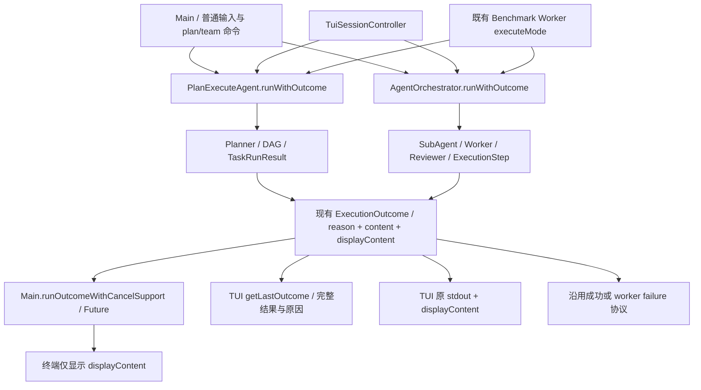

# 阶段十三补完：Plan / Team 根任务结果结构化汇总

本轮读取 Notion 页末尾的阶段十三补完要求，直接修改当前工作区生产路径，保留首轮 ReAct→Headless→后台/API 改造。没有新增 Runtime、执行策略框架或结果类型，没有修改 Kernel、预算额度、压缩、模型提示词、工具参数或 L05。

## 1. 原来的真实边界

Plan：`Main / TuiSessionController → PlanExecuteAgent.run → Planner → executePlan → executeTaskBatch → TaskRunResult(ExecutionOutcome)`。任务内部有明确原因，但根 executePlan 返回 String，PlanRunOutcome 还根据正文是否以✅开头决定记忆提取资格，调用者拿不到根原因。

Team：`Main / TuiSessionController → AgentOrchestrator.run → planner SubAgent → Worker/Reviewer → ExecutionStep → 根 String 汇总`。Worker 的 AgentMessage 已有 outcome，根汇总仅按步骤状态拼文本；预算原因可能只留在子结果，模型错误/部分内容也会被120字展示预览掩盖。

全局调用搜索还发现 `BenchmarkWorkerMain`、`BenchmarkRelayWorkerMain` 的现有 executeMode 使用上述 String 根入口。它们需要判断是否成功，故本轮迁移现有接线；不是新建评测入口、恢复大规模评测或更改评分规则。

后台/API 的真实接线仍为 `Main.runHeadlessTask → Agent.runWithOutcome → TaskRunner`。当前没有 Plan/Team 路由，本轮没有硬造该路径。

## 2. 实际生产改造

| 文件 | 实际变化 |
| --- | --- |
| `agent/ExecutionOutcome.java` | 复用原类型和原因枚举，增加 displayContent；保留原两参数构造。增加两种策略共用的根原因汇总规则。 |
| `agent/PlanExecuteAgent.java` | 增加两个 typed 根入口，executePlan/cancelPlan 返回 outcome，现有 PlanRunOutcome 持有它；根据真实任务结果/依赖状态汇总，不解析正文。保留流式失败片段与实际工具输出；取消提示本身不充当工作证据。 |
| `agent/AgentOrchestrator.java` | typed 根入口及步骤原因/错误信息；规划失败、Worker预算/取消/异常、未执行依赖准确汇总；根机器结果保留完整内容，旧显示仍用原预览。 |
| `agent/SubAgent.java` | 已处理的 Worker IOException 保留实际工具和流式部分输出，避免根层只能拿到错误通知。 |
| `agent/Agent.java` | 接同一 displayContent 语义；增加真实 explicit-task typed 入口供现有 Worker 使用；首轮 Headless 链继续接 content。 |
| `cli/Main.java` | 普通三种模式都调用 typed 入口；Future/取消包装返回 ExecutionOutcome，只在最后展示 displayContent。保留旧 String 取消包装供原命令使用。 |
| `tui/TuiSessionController.java` | /plan、/team、ReAct 路由读取 typed 根结果，getLastOutcome 保留原因与完整内容，显示层仍合并原 stdout 与 displayContent；开始新任务和外层异常时不复用上次状态。 |
| `eval/benchmark/BenchmarkWorkerMain.java` | 现有三模式 executeMode 返回 outcome，保留原 provider证据/失败优先处理，再阻止非完成结果进入 success 协议。 |
| `eval/benchmark/BenchmarkRelayWorkerMain.java` | 现有三模式及既有双轮 ReAct 调用 typed 入口；非完成发已有 worker failure，不继续下一轮。保留原错误协议及中性错误描述，不外传原异常详情。 |

原 `ExecutionOutcome(reason, content)` 构造仍将展示内容默认设为 content。第三字段的具体必要性：Plan 已经流式展示的输出会从返回文本中省略，Team 显示只预览120字。机器结果不能因此缺失，而 CLI/TUI 也不能再次打印完整正文。现在 `content` 是完整根交付内容，`displayContent` 是剩余展示内容；不引入平行 AgentResult。

`run()` / `runExplicitTask()` 保留字符串接口，返回 displayContent。CLI/TUI 的生产模式路径和既有 Benchmark Worker 实际使用新入口，不是只新增无人调用的方法。Headless、TaskRunner、SQLite/API 的状态映射沿用首轮实现，本轮未改动。

## 3. 修改后调用链

## 4. 根状态怎样汇总

- Plan 只有原依赖与完成条件满足、必需任务完成时才是 COMPLETED。TaskRunResult 的预算原因直接传根结果，跳过的依赖不算成功；Task/model异常失败保留实际部分结果。允许的重规划成功后按新计划实际结果决定，不因过去一次可恢复失败永久判失败。
- Team 保留 Worker 的具体终止原因。预算结果不启动 Reviewer/依赖；取消阻止后续调度；初次 Worker 模型错误为 MODEL_ERROR，执行错误为 EXECUTION_ERROR，空结果/无效计划不视为正常完成。
- 多种子原因并存时使用明确优先级：CANCELLED → EXECUTION_ERROR → MODEL_ERROR → TOKEN_BUDGET_EXCEEDED → HARD_ITERATION_LIMIT → STAGNATION_DETECTED → COMPLETED。单个根原因不是所有子原因的替代，子任务/步骤保留各自事实。
- 原来的 Worker 修复流程有一处真实错误：先有旧结果，Reviewer要求修复，两次修复模型请求都失败，调度层仍会 markStepCompleted。本轮保持两次修复上限和原流程，仅在最终 Worker 未完成时标 FAILED，阻止依赖；旧结果、来源 activation 与错误独立保留。
- Reviewer 的 JSON 通过/拒绝策略未重写。Reviewer自身异常时尽力接受已有结果、最终审阅拒绝仍保留结果的既有策略继续存在；因此 COMPLETED 表示现有执行策略正常结束，不等于客观验收通过。该验证/恢复策略仍留阶段十六。

CLI即时ESC仍保留原Future取消/返回确认方式，不因本轮改造宣称已经等待清理完毕或必然展示全部取消中输出。Plan/Team本身的typed取消结果保留实际已取得内容；跨入口取消确认、最终结果与资源清理归属是阶段十四的问题。

## 5. 验证与失败调查

JDK17.0.18，Maven显式 `-DskipTests=false`。最终14类 **132项通过，0失败、0错误、0跳过**；原固定离线集 **35/35**。两组有重叠，不累加成独立用例总数。逐类结果、源码SHA和离线结果见同目录 [validation.json](harness-stage13-completion-validation-2026-10-28.json)。

RootModeOutcomeTest 的19项包含：

- Plan/Team × 正常、流式成功、硬轮数预算、模型IOException、流式部分失败、取消，共12项，经真实 Main typed取消包装返回，核对根原因、完整内容和请求数；预算/失败场景存在依赖任务，核对没有额外依赖、Reviewer或重规划请求。
- 两种模式的旧String接口与displayContent一致，共2项；不以“有文字”判断成功。
- 真实TUI /plan与/team 路由各验证预算与流式展示，共4项，检查getLastOutcome及完整正文仅展示一次。
- Worker修复连续异常1项，确认旧结果保留但根失败，不启动依赖或再次Reviewer。

另外复跑 Plan/Team原调度、取消隔离、Observer、Kernel、预算收尾、首轮真实Headless/SQLite/HTTP、旧数据库与终态竞态测试。BenchmarkWorkerProcessTest 只跑本地协议与独立JVM夹具，没有启动真实或Docker评测。新根测试直接验证的是硬轮数预算；Token/停滞原因沿同一汇总规则透传，首轮Headless回归含这些场景，不能声称本轮对Plan/Team的每个预算类型都单独做了真实模型测试。

中间运行保留了不利结果：

1. 首轮已有63项通过。扩充范围后的130项有4项断言失败、2项错误；不是历史quick失败。
2. Plan取消无实际内容时，把取消通知也保存成部分结果，破坏原显示；生产代码修正为只保留实际工具/流式证据，旧取消断言恢复通过。
3. 旧Team观察测试期待“Worker重试全失败仍完成”，与本轮明确目标冲突；生产状态修正后测试加强为根MODEL_ERROR/步骤FAILED/WORKER_ERROR，同时保留原activation来源、原结果指纹和脱敏断言，未删用例或降低标准。
4. TUI测试因异步SideGit句柄导致Windows临时目录删除错误；夹具关闭与结果路由无关的SideGit功能，未跳测试或改产品快照代码。展示检查最初把Markdown下划线及换行当原样字符，改用无Markdown歧义的正文、仅归一化换行空白，仍严格检查完整正文一次。
5. 修正后窄范围42/42，最终扩展相关范围132/132；不把重复运行累加。

模型全部为受控本地实现，真实工具只读临时证据文件/既有pom.xml；HTTP与SQLite回归使用本地服务/临时数据库。没有外网模型、云端Trace、Docker或大型Benchmark，没有修改评分标准、固定用例、模型提示词和工具参数规则。完整quick未运行，已知历史失败未修复。git diff --check通过，已有工作区修改保留。

## 6. 仍保留的接口和下一步

已迁移：普通CLI三模式、TUI三模式、既有Benchmark三模式和其双轮ReAct内部执行接线；首轮ReAct→Headless→TaskRunner→后台/API继续通过回归。

未新增或未扩大：后台/API仍只执行ReAct；微信仍使用ReAct旧展示接口，固定LiveHarness文本评测入口也未改。Benchmark外部冻结协议仍使用既有worker failure分类，没有新增独立取消/预算字段；内部按typed原因作失败决策，未实跑其完整relay/模型评测，不能声称正式评测或模型质量得到验证。

没有改Kernel、CancellationContext、所有线程池、Token用量归集、公共请求准备、Deadline、压缩或Reviewer整体策略。三种模式仍保留各自循环和调度。无相同条件真实模型对比，不能声称成功率、速度或成本提升。

下一项应是阶段十四的根任务作用域：明确不同入口的任务ID、Token、线程与资源归属，逐步把复用线程/后台/API接到显式绑定，区分取消请求确认与实际清理完成，避免全局fallback或迟到结果影响独立任务。本轮结构化结果为此提供状态依据，不以新建Deadline代替生命周期治理。
