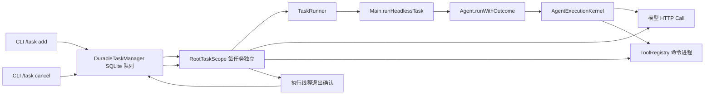

# 阶段十四：根任务取消与清理确认

## 实际调用链

`RuntimeApiServer.runTurn` 也在执行线程中使用独立 `RootTaskScope`。API 当前没有取消路由；这里接入作用域只消除并发 turn 借用其他任务取消信号的风险。

## 修改前的问题和现在的边界

修改前 `DurableTaskManager.cancel` 从 `runningTasks` 删除线程、立刻 `interrupt()` 并把行写成 `canceled`。数据库处于 running 与线程登记之间存在空窗；此时取消找不到线程。`canceled` 也不能说明线程或资源已经退出。`CancellationContext.current()` 在调用线程没有 Token 时读取一个进程级共享 Token；预先创建的线程池可能错误借用另一个任务的取消信号。

现在任务领取和作用域登记在同一把锁下完成。作用域拥有一个 `CancellationToken` 和根执行线程；`CancellationContext.bind` 在 `TaskRunner` 调用期间绑定，结束后恢复。模型 HTTP Call 和命令进程继续通过已有 `onCancel` 注册，在同一任务的 Token 取消时撤销；其关闭与结果获取仍由模型客户端、工具执行器负责。Plan 子任务和 Team Worker 现有传播路径依赖线程继承或显式 `bind`，本轮没有重写它们的调度。

| 事实 | 表示方式 | 含义 |
| --- | --- | --- |
| 取消已请求 | `reason=CANCELLED`, `status=canceled` | 终态决定已提交，禁止迟到成功覆盖 |
| 执行尚在退出 | `cleanup_state=cancel_requested` | 已发 Token 取消和线程中断 |
| 有界等待到期 | `cleanup_state=incomplete` | 2 秒内未确认根执行线程退出 |
| 执行线程退出 | `cleanup_state=stopped` | `TaskRunner` 返回或抛出，并解除线程绑定 |
| 尚未启动的任务取消 | `cleanup_state=not_started` | 没有执行线程需等待 |

正常任务先标记 running，在执行线程真正结束后标记 stopped。历史数据库增加可空 `cleanup_state`；旧行的空值表示未知，不根据旧正文推断。进程重启时旧 running 行重排队，并标记前次执行的退出未确认；新一轮真正开始会重新写 running。`/task log` 显示清理状态。

取消终态只提交一次。2 秒等待在管理器锁外进行，其他任务可继续读写数据库。若自定义 Java 操作忽略中断，状态保持 canceled、清理标为 incomplete；其日后退出才改为 stopped，迟到的成功和异常不会覆盖 canceled。若它返回 `CANCELLED` 并携带真实部分输出，仍按阶段十三规则补存正文，不改终态时间。

## 资源所有权与限制

- `DurableTaskManager` 拥有任务线程池和 SQLite 连接；每个后台任务自己的 `RootTaskScope` 拥有取消信号和执行线程的退出确认。
- 模型客户端拥有单次 HTTP Call 及取消注册；`ToolRegistry` 拥有命令进程、输出读取线程和有界进程树清理。取消作用域只发信号，不冒充这些资源的所有者。
- `AgentOrchestrator` 自己拥有 Team Worker/Reviewer 线程池及阶段九的有界清理；本轮没有将其清理结果汇入后台 `cleanup_state`。目前后台也只支持 ReAct。
- CLI inline、TUI、微信仍使用旧根任务入口。它们的单次取消传播已存在，但尚未接入同一清理状态契约。API 未提供取消路由。
- `stopped` 确认根执行线程退出及该线程同步等待的操作结束，无法证明任意脱离作用域的自定义线程、MCP 服务或脱离进程树的外部进程已结束。

## 验证

JDK 17 定向测试：`CancellationContextTest,DurableTaskManagerTest,RuntimeApiServerTest,HeadlessTaskOutcomeTest,RootModeOutcomeTest,TeamCancellationTest,CommandCancellationTest,AbstractOpenAiCompatibleClientRetryTest,PlanExecutionControlTest`，最终 83 项通过、0 失败、0 错误、0 跳过。覆盖独立任务隔离、领任务竞态、2 秒等待和超时、管理器关闭、迟到结果不覆盖、真实 Headless 部分正文、本地 HTTP 取消和本地命令进程树退出。原离线评测 35/35。中间一次 39 项补测出现 Windows 临时日志文件句柄占用，属于测试夹具路径问题；将夹具日志放到 `target` 后同一组及最终全组复测通过。未运行真实模型、Docker、全量 quick，不能推断成功率/成本/耗时提升。

下一阶段若处理公共模型请求准备和用量归集，应以这个根作用域为任务边界，在 Kernel/客户端的现有请求入口关联同一任务的 Usage；保持 Token 取消信号与模型计费 Token 概念分离，且不要由后台取消状态推算模型是否停止计费。
