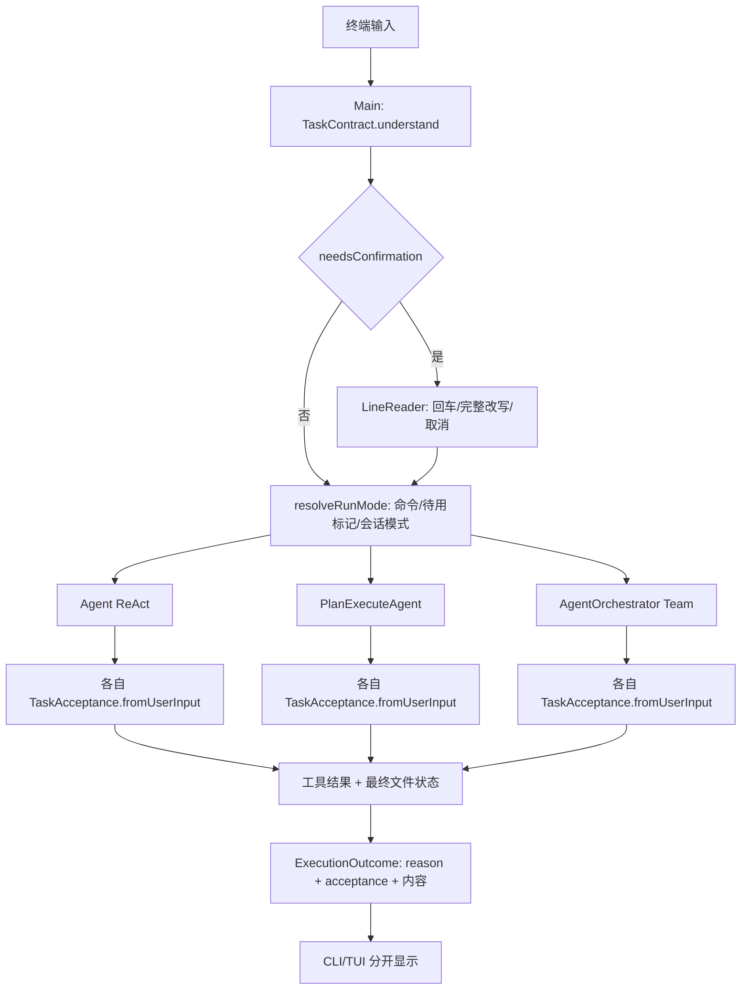
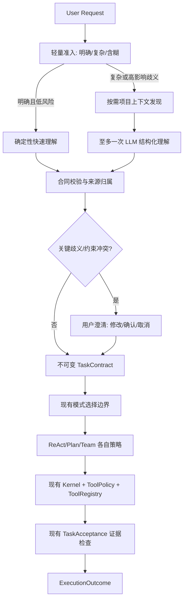

# PaiCLI Task Understanding 2.0：源码审计与实施蓝图

日期：2026-10-30。本轮只读审计和设计；未修改生产代码、测试或既有评测结果。以下路径均以当前工作区为准，历史报告不作为实现证据。

## 1. 当前实际调用链

- `TaskContract.java:9-44` 的字段只有原文目标、字符串约束、交付物、验收文本、确认布尔值和不确定性文本。三个正则提取文件/内容/命令；约束及模糊判断依赖固定词与长度。`goal` 是原文复述，尚无任务类型、依赖、范围、字段来源或项目证据。
- `Main.java:982-1031` 先调用 `understand`，短而含糊时用 `LineReader` 允许完整改写，之后由 `resolveRunMode` 依据显式命令和会话状态选模式。**模式选择不消费 TaskContract**；三模式只收到文本。
- `TuiSessionController.java:260-310` 对含糊请求要求重新提交；它和 CLI 的确认交互不同。Headless `Main.java:1135` 直接进入 ReAct，未经过同一确认边界。
- `TaskAcceptance.java:51-76` 在每种模式内再次调用 `TaskContract.understand`。`USER` 与 `USER_INTERPRETED` 进入确定性检查；没有模型候选/用户确认后的条件状态。文件检查使用 `PathGuard` 和最终文件状态；命令条件匹配本轮 `execute_command` 的真实工具结果。
- `Agent.java:250,343,393-399`、`PlanExecuteAgent.java:358,1084,390`、`AgentOrchestrator.java:233,1086,251` 分别创建验收器、收集工具结果并给根结果附上验收结论。Plan 重规划共用一次根验收器；Team 收集 Worker 结果，Reviewer 输出不充当确定性证据。
- `ExecutionOutcome.java:6-47` 的 `reason` 是执行终止，`acceptance` 是独立结论。预算/取消/异常通常给 `notEvaluated`；自然语言条件即便被模型最后回答认同，也仍需真实文件或命令证据。
- `AgentExecutionKernel.java:27-123` 管理模型请求、Token 记账、取消准入和工具授权执行；它不是任务理解器。`TurnToolPolicy`、`ToolRegistry`、`PathGuard` 已承担权限和路径边界。
- `Planner.java:71` 将目标拆为计划，是执行策略内的规划；不能用它替代执行前的用户意图理解。

## 2. 结构性问题与影响

| 问题 | 源码证据 | 影响 |
| --- | --- | --- |
| 合同没有作为同一对象进入执行模式 | Main 创建合同后仍传 `taskInput, confirmedInput`；三模式各自再解析文本 | 澄清、来源、上下文发现结果不能可靠传到执行/验收；不同入口易出现不同理解 |
| 理解只覆盖局部字符串模式 | TaskContract 三个 `Pattern`，约束 `contains`，模糊判断 `length <= 20` | “优化登录模块”可能不会澄清性能/安全/范围；普通长文本可能掩盖关键歧义 |
| 目标、约束和验收混在文本里 | `goal` 原文，`acceptanceLines` 字符串；TaskAcceptance 再解析 | 不知道哪项是用户要求、启发式解释还是模型建议；不能验证冲突或候选条件的授权 |
| 上下文发现发生在执行内部 | ReAct 的 MemoryManager/ProjectMemoryLoader；Plan/Worker 各自读取上下文 | 执行前无法基于项目事实判断问题范围；重复发现可能增加调用与噪声 |
| 澄清只覆盖一类交互入口 | Main 读一行改写，TUI 要求重投，Headless 直入 ReAct | 同一模糊任务在入口间行为不同；缺少“等待澄清”的结构化状态 |
| 现有评测不测理解质量 | `benchmarks/harness-offline` 偏执行回归，live cases 偏任务结果 | 35/35 无法证明意图、约束、歧义或合同质量 |

## 3. 目标边界

理解器只决定“用户要求是什么、哪些仍未知”；不执行任务、不代替 Planner 拆步、不把模型建议授权为文件修改或工具权限。模式选择仍服从显式 `/plan`、`/team` 和现有会话设置；自动选择策略属于后续独立阶段。

### 规则与模型分工

- 快速路径：普通问答、明确的单文件查看/创建、精确命令及用户写出的验收条件；使用现有轻量规则，不增加模型请求。规则必须以高精度为主，无法判断时返回未知。
- 语义路径：多目标、跨模块修改、多个限制或“优化登录模块”这类不同解释会改变范围/风险的任务。复用现有 `LlmClient`，发**最多一次**无工具的结构化理解请求；保留现有 Provider 取消、重试和根任务请求预算，不绕开准入。理解失败或 JSON 无效时退回已知字段并保留未知，不循环重问模型。
- 不从自报 `confidence=0.9` 直接决定执行。澄清依据应是可解释的冲突/缺项：例如优化维度未指定且会影响修改文件，或用户同时要求只读和直接修改。模型置信度只作为辅助排序，需离线校准；没有基线前不设伪精确阈值。

### 按需上下文发现

先从用户提及的文件/模块和仓库根级元数据开始；只读、限量（文件数、字节、时间），经现有路径围栏与工具权限。可复用 `ProjectMemoryLoader`、`glob_files`、`grep_code`、`read_file` 和已有代码搜索；不要让理解器直接绕过 `TurnToolPolicy` 扫全仓库。内容只提供与目标定位有关的片段和来源路径。普通问答不读仓库；路径不明确且候选过多时澄清。发现结果属于当前根任务，不作为下一任务的授权或证据；缓存只可复用无权限含义的索引，并按工作区版本失效。

### 合同结构与来源

沿用 `TaskContract`，下一轮渐进演进为不可变结构：原始用户输入、规范化目标、意图/任务类型、明确约束、范围（含禁止触碰范围）、交付物、依赖/先决条件、未知项、验收条件、项目上下文引用、澄清决策。每个条件包含 `origin`（`USER_EXPLICIT`、`RULE_INTERPRETED`、`MODEL_CANDIDATE`、`USER_CONFIRMED`）、原文证据位置、可验证性（确定性/需人工或模型评审/暂不可验）和是否获准用作验收。模型候选默认不能触发权限提升或被记为用户要求；用户确认后记录确认版本，保留原候选来源。模型产出从来不是执行证据。

### 澄清契约

只问会改变范围、风险或交付物的一条关键问题；展示当前理解、可选解释和默认安全动作。用户可确认、改写或取消。改写后重新校验合同，并让**同一合同实例**进入选定模式；不要仅把改写文本传进去后各模式重解析。Headless/API 返回结构化“需要澄清”而不是阻塞读终端；TUI 用可恢复的交互状态，避免静默丢任务。执行中的权限请求继续由现有 HITL 处理，不能被任务理解阶段代替。

## 4. Task Understanding 独立评测

首批建议 40–60 条人工标注任务，按问答、代码分析、Bug 修复、功能开发、重构、性能、安全、跨模块项目任务分层；包含否定约束、冲突约束、同名模块、多义“优化”、无明确验收、用户改写及恶意仓库内容。每条保存原任务、最小仓库快照、金标目标/意图/约束/范围/依赖/未知项、允许的澄清问题、候选验收及来源。分离训练/调参样本与盲测样本，保留每次运行结果。

指标分别报告：意图/类型准确率；目标关键槽位 F1；用户约束召回率（高风险约束另列漏检率）；范围文件/模块 precision、recall；依赖边 F1；上下文发现证据相关率和越权率；应问/不应问的澄清精确率、召回率及单次问题有效率；验收条件可执行率、用户来源归属准确率、虚构事实率；合同 schema 有效率；额外模型请求、Token、耗时、失败回退率。人工判定语义质量，确定性脚本判定 schema/路径/来源；LLM Judge 分数单独展示，不能替代人工金标。Langfuse Trace 关联本地 `task_id`，观察理解请求与后续执行，但 Trace 存在不等于理解正确。

## 5. 分阶段迁移与生产模块

1. **先贯通合同对象（下一轮首改）**：`Main`、`TuiSessionController`、`Agent`、`PlanExecuteAgent`、`AgentOrchestrator`、`TaskContract`、`TaskAcceptance`。CLI 在模式选择前创建/确认一次合同；模式新增接收合同的兼容入口，旧字符串入口内部仍可构造合同。验收器直接消费合同条件及来源，停止三次重解析。先迁移交互 ReAct，再 Plan、Team；同一任务的显式权限文本仍来自原始用户输入。验证改写条件、来源、三模式一致性和旧 API。此步不新增模型调用。
2. **结构化语义理解**：在合同贯通后增加一个有真实 CLI/TUI 调用者的理解服务；复用 `LlmClient` 和请求预算，最多一次结构化请求，Java 校验字段、来源、路径和冲突。非法响应回退快速路径。先只产出候选/未知，不自动扩大执行权限。
3. **按需上下文发现与澄清闭环**：接入受限只读项目发现；CLI/TUI/API 分别实现确认或结构化待澄清状态。发现与澄清均在根任务作用域内，取消/预算停止不丢原始用户输入。
4. **独立评测与渐进启用**：先离线金标和受控 Provider，随后有限真实模型任务，比较理解质量与额外成本；按任务类别灰度开启语义路径。只有证据显示质量/成本可接受，才考虑自动策略选择。

风险：模型误读约束、仓库内容提示注入、额外请求导致预算提前耗尽、确认后权限语义漂移、重复解析产生不一致、上下文泄露和高成本仓库扫描。每阶段都保留旧入口、来源信息与失败回退；不把“模型认为任务完成”用于验收。

## 结论

当前 PaiCLI 已有执行后的证据验收，但执行前的理解仍是**局部文本提取**：缺少结构化意图/范围/依赖、受限项目发现、模型候选的来源治理、跨入口一致的澄清状态，且合同没有真正穿过模式边界。最优先的生产改造是**把一次创建并确认的 TaskContract 作为根任务对象传给 ReAct、Plan、Team 和 TaskAcceptance**。这先解决真实的不一致与丢失问题，为以后的一次性 LLM 语义理解提供安全落点；直接新增模型理解器会把输出继续降格为文本，难以审计来源和权限。
